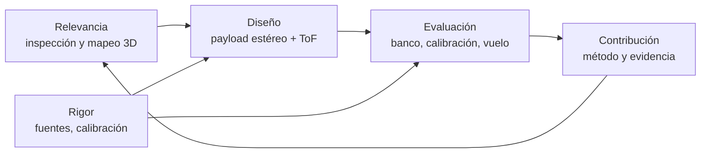

# Metodología del proyecto

> Estado: Borrador · Versión: 0.1 · Revisión: 2026-11-21 · Responsable: rol de Gestión de Proyecto

## 1. Propósito

Definir **cómo se trabaja** en este proyecto: fases, artefactos, decisiones,
verificación y definición de “hecho”. La metodología debe ser rigurosa para un
jurado técnico y ligera para un equipo pequeño.

El proyecto se basa en la metodología del **rover** (SDLC + DSR), pero el
artefacto es el **payload de visión de un dron**, no el dron completo. La
cotización de la BOM es un artefacto de **G0 (concepción)**, no una autorización
de compra.

## 2. Enfoque: SDLC iterativo + Design Science Research

| Marco | Aporta | Se aplica en |
|---|---|---|
| **SDLC iterativo e incremental** (ISO/IEC 12207) | Fases, puertas, trazabilidad, configuración, verificación | Todo el ciclo |
| **Design Science Research** (Hevner et al., 2004) | Rigor, relevancia, evaluación del artefacto | Investigación y validación |
| **Ingeniería de requisitos** (IEEE 29148) | Requisitos verificables y criterios de aceptación | Fase 02 |
| **Gestión de riesgos** (ISO 31000) | Identificación, evaluación, tratamiento y seguimiento | Transversal |
| **Pruebas por niveles** (ISO/IEC/IEEE 29119) | Unitarias, integración, sistema, aceptación | Fase 06 |

### Ciclo DSR aplicado

- **Relevancia:** un dron necesita percibir profundidad y obstáculos con un
  presupuesto y un peso limitados.
- **Diseño:** el artefacto es el sistema completo (hardware + software +
  documentación + evidencia), no solo el código.
- **Evaluación:** experimentos reproducibles con métricas (error de profundidad,
  FPS, latencia, temperatura, consumo).
- **Rigor:** cada decisión se apoya en fuentes o experimentos; los supuestos se
  declaran.
- **Contribución:** un método reutilizable para futuros payloads de visión.

## 3. Fases y puertas

| Fase | Entradas | Actividades | Salidas | Puerta |
|---|---|---|---|---|
| 0. Concepción | Necesidad, contexto | Investigación, benchmarking, alcance, BOM | Visión, contexto, riesgos, cotización | **G0** |
| 1. Requisitos | Visión aprobada | Elicitación, análisis, priorización | RF, RNF, historias, trazabilidad | **G1** |
| 2. Arquitectura y diseño | Requisitos | Arquitectura, interfaces, ADRs, diseño | Diagramas, ADRs, BOM, diseño | **G2** |
| 3. Implementación | Diseño aprobado | Captura, calibración, pipeline, tests | Incremento ejecutable | **G3** |
| 4. Verificación | Incremento | Pruebas de integración, sistema, aceptación | Resultados, evidencia, desviaciones | **G4** |
| 5. Operación y demo | Sistema validado | Preflight, ensayos, presentación | Runbook, evidencia final, guion | **G5** |

### Criterios de las puertas

#### G0 — Concepción

- [ ] Problema y alcance escritos y acotados.
- [ ] Contexto del dron y de la visión verificado con fuentes.
- [ ] Al menos una alternativa tecnológica comparada (Pi 5 vs Jetson, CM3 vs GS,
      VL53L1X vs VL53L5CX vs TFmini).
- [ ] Riesgos principales identificados.
- [ ] Cotización con precios, stock y alternativas.
- [ ] El usuario aprueba el alcance y el presupuesto.

#### G1 — Requisitos

- [ ] Cada requisito tiene ID, prioridad y criterio de aceptación verificable.
- [ ] RF y RNF separados.
- [ ] Trazabilidad inicial requisito → prueba.
- [ ] No hay requisitos ambiguos (“rápido”, “preciso”) sin métrica.

#### G2 — Arquitectura y diseño

- [ ] Arquitectura de componentes, interfaces y despliegue.
- [ ] ADRs para decisiones estructurales.
- [ ] Interfaces de datos versionadas (topics, YAML, MAVLink).
- [ ] Análisis de seguridad y FMEA inicial.
- [ ] Revisión por pares sin bloqueantes.

#### G3 — Implementación

- [ ] Build reproducible en el entorno objetivo.
- [ ] Pruebas unitarias en verde.
- [ ] Lint y validación de sintaxis sin errores.
- [ ] Documentación de instalación actualizada.
- [ ] Sin secretos ni artefactos generados versionados.

#### G4 — Verificación y validación

- [ ] Casos de prueba ejecutados y registrados.
- [ ] Métricas comparadas con los umbrales de los RNF.
- [ ] Evidencia con metadatos, logs y hash.
- [ ] Desviaciones documentadas y aceptadas por el responsable.
- [ ] Regresión ejecutada tras correcciones.

#### G5 — Operación y demo

- [ ] Runbook y preflight probados.
- [ ] Ensayo completo con tiempo real.
- [ ] Contingencias definidas (fallo de cámara, ToF, calor, batería, enlace).
- [ ] Evidencia final y guion de presentación.
- [ ] Revisión de seguridad antes de volar con público.

## 4. Cadencia de trabajo

El proyecto se planifica por **sprints de 2 semanas** y **hitos relativos**
(T0 = 2026-11-21). No hay una fecha de competencia asumida; si aparece, se
comprime el plan.

| Ritual | Frecuencia | Salida |
|---|---|---|
| Planificación de sprint | Cada 2 semanas | Objetivo, backlog priorizado, riesgos |
| Daily / async | Diario | Bloqueos y avances |
| Revisión de sprint | Cada 2 semanas | Demo, evidencia, aceptación |
| Retrospectiva | Cada 2 semanas | Acciones de mejora |
| Revisión de puerta | Al cerrar fase | Checklist G0–G5 firmado |
| Revisión de riesgos | Mensual | Registro actualizado |

### Regla de tiempo para spikes

Un *spike* tiene:

- Una pregunta concreta.
- Un tiempo máximo (4 horas por defecto, máximo 1 día).
- Una conclusión escrita, aunque sea “no funciona”.
- Ningún compromiso de producto hasta pasar G4.

## 5. Gestión de cambios

### Cambio de requisito

1. Solicitud en la bitácora con motivo.
2. Análisis de impacto (diseño, pruebas, presupuesto, calendario).
3. Aprobación del responsable de producto.
4. Actualización de requisito, trazabilidad y casos de prueba.
5. Registro en `CHANGELOG.md`.

### Cambio arquitectónico

1. Nuevo ADR con contexto, alternativas, decisión y consecuencias.
2. Revisión técnica.
3. Si reemplaza un ADR anterior, se marca como `Reemplazado por ADR-XXXX`
   (nunca se borra).
4. Actualización de interfaces y diagramas.

### Cambio de código

1. Rama corta desde `main`.
2. Commits pequeños con Conventional Commits.
3. `make check` antes de abrir revisión.
4. Revisión por pares para cambios de calibración, seguridad o interfaces.
5. Merge con historial lineal o squash, según preferencia del equipo.

## 6. Configuración y reproducibilidad

- **Versiones fijadas:** OS, libcamera, Picamera2, OpenCV, ROS 2, MAVLink.
- **Entorno declarado:** [`../05-implementacion/entorno-desarrollo.md`](../05-implementacion/entorno-desarrollo.md).
- **Calibración versionada:** YAML con fecha, baseline, foco, RMS y hash.
- **Datos crudos:** frames + profundidad + pose + logs; no solo el resultado.
- **Evidencia:** cada ejecución guarda host, versiones, comando y hashes.
- **BOM:** CSV + documento; los totales se validan con `make bom`.

## 7. Métricas del proyecto

| Métrica | Objetivo | Cómo se mide |
|---|---|---|
| Cobertura de trazabilidad | 100 % de RF/RNF con prueba asociada | `scripts/docs/check_docs.py` |
| Requisitos verificables | 100 % con criterio medible | Revisión G1 |
| Pruebas unitarias | 100 % en verde | `make test` |
| Error de profundidad | ≤ 10 cm a 5 m | Tablero + ground truth |
| FPS de estéreo | ≥ 5 fps a 640 × 360 | Medición en Pi 5 |
| Latencia de obstáculo | ≤ 200 ms | Timestamp captura → salida |
| Temperatura | < 80 °C sin throttling | `vcgencmd` |
| Autonomía de registro | ≥ 30 min | NVMe + tamaño de sesión |
| Documentos con enlaces válidos | 100 % | `make docs` |
| Riesgos con mitigación | 100 % de riesgos altos | Registro de riesgos |
| Evidencia por hito | ≥ 1 carpeta sellada | Registro de evidencias |

## 8. Herramientas

| Área | Herramienta | Nota |
|---|---|---|
| Documentación | Markdown + Mermaid + Git | Sin dependencias propietarias |
| Validación documental | `scripts/docs/check_docs.py` | Enlaces, IDs, ADRs, evidencia |
| Validación de BOM | `scripts/docs/check_bom.py` | Totales del CSV |
| Cámara | `rpicam-apps`, Picamera2 | Raspberry Pi OS / Ubuntu |
| Visión | OpenCV (SGBM, calibración) | CPU |
| Middleware | ROS 2 Jazzy (propuesto) | Integración con rover |
| Vuelo | MAVLink / MAVROS | Pose y telemetría |
| Evidencia | Scripts propios + SHA-256 | `scripts/evidence/` |

## 9. Referencias metodológicas

- ISO/IEC/IEEE 12207:2017 — Software life cycle processes.
- ISO/IEC/IEEE 29148:2018 — Requirements engineering.
- ISO/IEC/IEEE 29119 — Software testing.
- ISO 31000:2018 — Risk management.
- Hevner, A. R., et al. (2004). *Design Science in Information Systems Research*.
  MIS Quarterly, 28(1), 75–105.
- Wieringa, R. J. (2014). *Design Science Methodology for Information Systems
  and Software Engineering*. Springer.

Las fuentes concretas del dominio visión/dron están en
[`../01-investigacion/fuentes.md`](../01-investigacion/fuentes.md).
