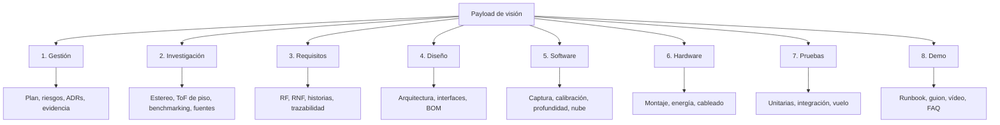
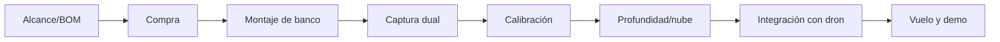

# Plan de proyecto

> Estado: Borrador · Versión: 0.1 · Revisión: 2026-11-21 · Responsable: rol de Gestión de Proyecto

## 1. Resumen

| Campo | Valor |
|---|---|
| Producto | Payload de visión estéreo + ToF de piso para dron |
| Objetivo | Profundidad, nube de puntos 3D y detección de obstáculos |
| Inicio | 2026-11-21 (T0) |
| Duración estimada | 14–18 semanas hasta demo de banco; 20–24 hasta vuelo |
| Equipo mínimo | 2–3 personas (visión, hardware, QA/seguridad) |
| Presupuesto hardware | S/ 1.805,36 (kit completo, con 5 %); S/ 1.537,61 si se baja a un ToF de 4 m |
| Metodología | SDLC iterativo + DSR, sprints de 2 semanas |
| Estado | Fase 0 — Concepción (G0) |

> **Supuesto:** no hay una fecha de competencia confirmada. Si aparece, el plan
> se comprime o se paraleliza. No inventar fechas ni normas.

## 2. Objetivos

### Objetivo general

Construir y validar un payload de visión que entregue profundidad métrica,
nube de puntos 3D y detección de obstáculos, con seguridad, telemetría y
evidencia reproducible, como base para un dron de inspección.

### Objetivos específicos

| ID | Objetivo | Indicador |
|---|---|---|
| OE-01 | Validar la captura dual en la Pi 5 | Dos cámaras detectadas y frames con timestamp |
| OE-02 | Calibrar el par estéreo | RMS < 0,5 px y baseline ±1 mm |
| OE-03 | Medir profundidad | Error ≤ 10 cm a 5 m |
| OE-04 | Generar nube de puntos | PCD/PLY con escala verificada |
| OE-05 | Integrar ToF de piso | Altura/referencia a ≥ 10 Hz; error ≤2 % o 5 cm |
| OE-06 | Detectar obstáculos | Latencia ≤ 200 ms en banco |
| OE-07 | Documentar y evidenciar | Trazabilidad 100 % y evidencia sellada |
| OE-08 | Preparar la demo | Guion de 5–10 min + vídeo |

## 3. Alcance por fases

| Fase | Semanas | Entregable principal | Puerta |
|---|---|---|---|
| 0. Concepción | T0–T2 | Visión, contexto, benchmarking, BOM, riesgos | G0 |
| 1. Requisitos | T2–T3 | RF, RNF, historias, trazabilidad | G1 |
| 2. Arquitectura y diseño | T3–T5 | Arquitectura, ADRs, diseño, interfaces | G2 |
| 3. Implementación de banco | T5–T9 | Captura, calibración, pipeline, tests | G3 |
| 4. Verificación de banco | T9–T12 | Métricas, nube, ToF de piso, evidencia | G4 |
| 5. Integración con el dron | T12–T16 | Montaje, pose MAVLink, pruebas en tierra | G3/G4 |
| 6. Vuelo y demo | T16–T20 | Runbook, ensayos, vídeo | G5 |
| 7. Cierre | T20–T22 | Informe, lecciones, evidencia final | — |

> Las semanas son relativas. La compra de hardware es el camino crítico: si el
> HAT o el ToF de mayor alcance se retrasan, la fase 3 se desplaza.

## 4. EDT / WBS

### Paquetes de trabajo

| WP | Nombre | Tareas | Responsable |
|---|---|---|---|
| WP-01 | Gestión | Plan, riesgos, puertas, cambios | Gestión |
| WP-02 | Investigación | Estéreo, ToF de piso, benchmarking, fuentes | Visión |
| WP-03 | Requisitos | RF/RNF, historias, aceptación | Producto |
| WP-04 | Arquitectura | Componentes, interfaces, ADRs | Visión |
| WP-05 | Captura | Picamera2, doble CSI, timestamps | Software |
| WP-06 | Calibración | Intrínseca, estéreo, foco, baseline | Visión |
| WP-07 | Profundidad | SGBM, filtros, nube, referencia ToF de piso | Visión |
| WP-08 | Integración | MAVLink, pose, topics, registro | Software |
| WP-09 | Hardware | Montaje, energía, térmica, vibración | Hardware |
| WP-10 | Pruebas | Casos, métricas, evidencia | QA |
| WP-11 | Seguridad | FMEA, preflight, failsafes | Seguridad |
| WP-12 | Demo | Runbook, guion, vídeo, FAQ | Comunicación |

## 5. Hitos

| Hito | Semana | Criterio de aceptación | Estado |
|---|---|---|---|
| M0 — Alcance y BOM aprobados | T2 | G0 cumplida | Pendiente |
| M1 — Requisitos congelados v1 | T3 | G1 cumplida | Pendiente |
| M2 — Arquitectura revisada | T5 | G2 cumplida | Pendiente |
| M3 — Captura dual en banco | T7 | Dos cámaras, frames y timestamps | Pendiente |
| M4 — Calibración válida | T9 | RMS < 0,5 px, baseline ±1 mm | Pendiente |
| M5 — Profundidad y nube | T11 | Error ≤ 10 cm a 5 m; PCD/PLY | Pendiente |
| M6 — Integración con dron | T16 | Pose MAVLink y montaje | Pendiente |
| M7 — Demo ensayada | T20 | Runbook probado y vídeo | Pendiente |

## 6. Camino crítico

Dependencias críticas:

1. **Compra del hardware antes de implementar.** Sin Pi 5, cámaras y ToF de piso no se
   puede validar nada.
2. **HAT/SSD y UBEC** son los suministros con más incertidumbre.
3. **Calibración** condiciona profundidad, nube y fusión.
4. **Pose MAVLink** condiciona la georreferencia; sin ella, la nube es local.
5. **Seguridad de vuelo** condiciona la fase 6; no se vuela sin preflight.

## 7. Presupuesto

| Bloque | Coste |
|---|---:|
| Núcleo de visión | S/ 1.403,00 |
| Núcleo operativo de banco | S/ 1.564,80 |
| Kit completo banco + vuelo (con 5 %) | S/ 1.805,36 |
| ToF local VL53L1X (≤4 m) | − S/ 255 (total S/ 2.073,33) |
| ToF 8×8 VL53L5CX (≤4 m) | − S/ 140 (total S/ 2.194,08) |
| Reserva recomendada (10 %) | ~S/ 234 |
| **Tope sugerido** | **S/ 2.600** |

> La BOM no incluye herramientas, dron, baterías de vuelo, repuestos mayores ni
> permisos. Ver [`../04-diseno/bom-peru.md`](../04-diseno/bom-peru.md).

## 8. Supuestos y restricciones

- La controladora de vuelo entrega actitud por MAVLink; la posición local es
  deseable pero no está garantizada.
- El dron puede cargar 250–350 g adicionales sin perder estabilidad.
- Hay espacio para una baseline de 150 mm.
- **Altura de operación:** 6 m en jaula/entorno cerrado; el TFmini Plus 12 m es
  la base. El VL53L1X y el VL53L5CX son de 4 m y no alcanzan.
- **Orientación:** cámaras al piso para mapeo; al frente para inspección. El ToF
  de piso solo es referencia directa si el piso es visible en la imagen (OQ-11).
- **Posicionamiento:** sin GPS en jaula; verificar optical flow/mocap/posición
  local de la FC (OQ-12).
- El equipo tiene acceso a una Pi 5, una cámara y un banco de pruebas; si no,
  la fase 3 se hace después de la compra.
- No se asume una licencia de vuelo ni un permiso aeronáutico; se tramitan antes
  de la fase 6.
- La operación será diurna, visual (VLOS) y en zona autorizada.

## 9. Riesgos de calendario

| Riesgo | Impacto | Mitigación |
|---|---|---|
| HAT/SSD sin stock | Retrasa el registro | Arrancar por microSD/USB; comprar después |
| ToF de piso falla a 6 m | No mide altura | TFmini Plus 12 m; barómetro/FC; validar rango |
| UBEC no disponible | Retrasa el vuelo | Usar BEC del dron; probar en banco |
| Falta de Pi 5 | Bloquea todo | Confirmar stock; alternativa Pi 4 (no ideal) |
| Calibración inestable | Retrasa G4 | Barra más rígida; recalibrar |
| Clima/permisos | Retrasa vuelo | Planificar ventanas; trámites temprano |

## 10. Siguientes pasos

1. Aprobar G0 (alcance, BOM, riesgos).
2. Confirmar stock y decidir ToF de piso (altura de vuelo).
3. Comprar el núcleo operativo de banco.
4. Implementar captura y calibración.
5. Medir y registrar evidencia.
6. Integrar con el dron y ensayar la demo.
