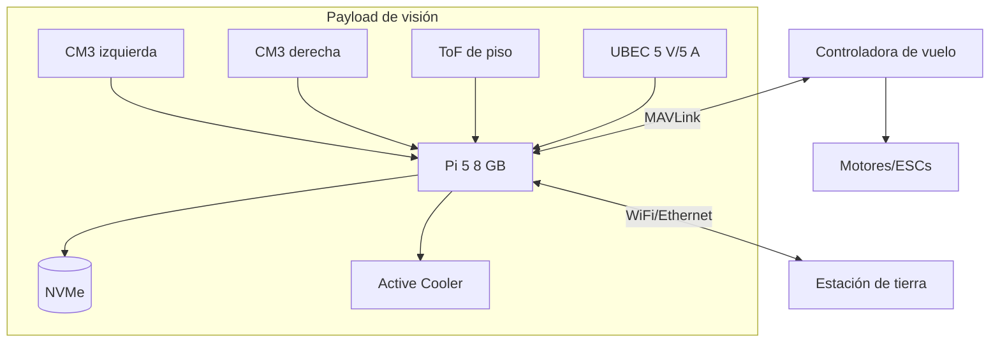
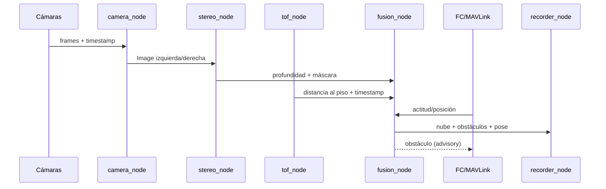

# Arquitectura de visión

> Estado: Borrador · Versión: 0.1 · Revisión: 2026-11-21 · Responsable: rol de Visión

## 1. Contexto

El payload de visión se monta en un dron que vuela **hasta 6 m en un entorno
cerrado/jaula**, sin GPS, y se comunica con la controladora de vuelo por MAVLink.
La visión no controla motores: publica profundidad, nube de puntos, obstáculos y
estado. La FC y el piloto conservan la autoridad.

## 2. Componentes

| Componente | Función | Tecnología | Interfaz |
|---|---|---|---|
| Cámara izquierda | Imagen del par estéreo | CM3 Standard, CSI | MIPI CSI-2 |
| Cámara derecha | Imagen del par estéreo | CM3 Standard, CSI | MIPI CSI-2 |
| ToF de piso | Distancia cámara–suelo / altitud | TFmini Plus 12 m (base); VL53L1X/8×8 ≤4 m | UART / I²C |
| Cómputo | Captura, calibración, pipeline | Raspberry Pi 5 8 GB | — |
| Almacenamiento | Registro y arranque | HAT+ M.2 + NVMe 128 GB | PCIe |
| Energía | 5 V/5 A | UBEC Matek / BEC del dron | XT60/XT30 |
| Refrigeración | Disipación | Active Cooler | Fan 4-pin |
| FC | Actitud/posición | ArduPilot/PX4 (por confirmar) | MAVLink UART/USB |
| Estación | Monitorización | WiFi/Ethernet | ROS 2 / HTTP |

## 3. Nodos lógicos

| Nodo | Responsabilidad | Entrada | Salida |
|---|---|---|---|
| `camera_node` | Captura dual, exposición, timestamps | CSI | `Image`, `CameraInfo` |
| `stereo_node` | Rectificación, SGBM, profundidad | `Image` ×2, calibración | `Image` (32FC1), `Disparity` |
| `tof_node` | Lectura del ToF de piso y altitud | ToF | `Range`, `Float32MultiArray` |
| `pose_node` | MAVLink → pose | MAVLink | `PoseStamped`, `TF` |
| `fusion_node` | Nube, obstáculos y referencia de piso | Depth, ToF, pose | `PointCloud2`, `Obstacle`, `ground_plane` |
| `recorder_node` | Registro y cierre ordenado | Todos | NVMe |
| `supervisor_node` | Modos, watchdog, salud | Estado | `DiagnosticStatus` |

> Los nombres son propuestos. La implementación puede ser ROS 2 o Python puro
> (ver ADR-0004); las interfaces se mantienen.

## 4. Flujo de datos

## 5. Modos

| Modo | Entrada | Salida | Condición |
|---|---|---|---|
| `BOOT` | Encendido | Autodiagnóstico | Tensión y temperatura OK |
| `CALIB` | Comando | YAML de calibración | Tablero detectado |
| `IDLE` | Comando | Sin captura | Espera |
| `CAPTURE` | Comando | Frames + profundidad | Cámaras OK |
| `SCAN` | Comando | Nube + registro | Pose disponible |
| `FAULT` | Error | Log + estado | Cámara/ToF de piso/térmica falla |
| `SHUTDOWN` | Comando | Cierre ordenado | Detener nodos y sincronizar |

Transiciones:

- `BOOT → IDLE` si el autodiagnóstico pasa; si falla, `FAULT`.
- `IDLE → CAPTURE` si las dos cámaras responden.
- `CAPTURE → SCAN` si hay calibración y pose.
- Cualquier modo → `FAULT` si se pierde una cámara, el ToF de piso o la temperatura
  supera el umbral.
- `FAULT → SHUTDOWN` si no se recupera en 5 s.

## 6. Despliegue

- Caja ventilada con la Pi 5, el HAT/SSD, el UBEC y el ToF de piso.
- Cámaras en una barra rígida de 150 mm, aisladas del frame.
- ToF **TFmini Plus 12 m** en la base, mirando al piso, con ventana/abertura y
  offset conocido respecto a las cámaras. Configuración A (cámaras abajo) para
  mapeo del suelo; configuración B (cámaras al frente) para inspección, con el
  ToF solo como altitud. Para 6 m, los ToF de 4 m no alcanzan.
- Sin GPS: usar posición local/optical flow de la FC o un frame local; registrar
  la limitación.
- Alimentación: XT60/XT30 → fusible 5 A → UBEC → USB-C/GPIO de la Pi 5.
- Datos: NVMe; WiFi/Ethernet solo para monitorización; deshabilitar WiFi/BT en
  vuelo si interfiere.
- Etiquetar cables y conectar a prueba de error.

## 7. Principios de diseño

1. **Visión advisory:** nunca controla motores.
2. **Fail-safe:** si el pipeline falla, la FC sigue volando; el payload se apaga
   o reinicia sin afectar la actitud.
3. **Timestamps deterministas:** cada dato lleva sensor time y host time.
4. **Calibración versionada:** YAML con hash; no se edita a mano.
5. **Registro local:** no depender del enlace de radio para la evidencia.
6. **Trazabilidad:** cada salida se puede reproducir con los datos crudos.

## 8. Fallos y degradación

| Fallo | Detección | Respuesta |
|---|---|---|
| Una cámara no responde | `camera_node` | `FAULT`; no publicar profundidad; avisar |
| ToF no responde | `tof_node` | Seguir con estéreo; usar barómetro/altitud de la FC; marcar sin referencia de piso |
| Pérdida de pose | `pose_node` | Nube local sin georreferencia; avisar |
| Sobrecalentamiento | `supervisor_node` | Bajar resolución; si persiste, `FAULT` |
| Tensión baja | ADC/UBEC | Avisar; apagar payload; FC decide |
| NVMe lleno | `recorder_node` | Rotar/borrar lo no esencial; avisar |
| Enlace de red perdido | `supervisor_node` | Seguir registrando localmente |

## 9. Decisiones abiertas

- Modelo de FC y dialecto MAVLink (OQ-04).
- ROS 2 vs Python puro (OQ-06).
- Uso de `OBSTACLE_DISTANCE` o topic propio (OQ-04).
- Georreferencia con GPS o solo pose local (OQ-09).

## 10. Referencias

- ADR-0001 a ADR-0005.
- [`interfaces.md`](interfaces.md), [`seguridad.md`](seguridad.md).
- [`../04-diseno/diseno-vision.md`](../04-diseno/diseno-vision.md).
