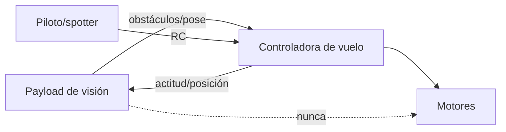

# Seguridad del payload de visión

> Estado: Borrador · Versión: 0.1 · Revisión: 2026-11-21 · Responsable: rol de Seguridad

## 1. Principio

La visión es **advisory**. No controla motores, no sustituye la controladora de
vuelo y no es un sistema de evitación crítico. Su fallo debe degradar la misión,
no la estabilidad del dron.

## 2. Cadena de seguridad

| Capa | Control | Responsable |
|---|---|---|
| 1 | Geofence y límites de altura/distancia en la FC | Piloto |
| 2 | Failsafe RTL/aterrizaje por pérdida de enlace/batería | Piloto |
| 3 | Piloto y spotter en VLOS | Seguridad |
| 4 | Preflight y checklist | Seguridad |
| 5 | Payload con fusible, UBEC y apagado ordenado | Hardware |
| 6 | Watchdog y modo `FAULT` | Software |
| 7 | Revisión postflight y evidencia | QA |

## 3. FMEA inicial

Escala: S = severidad (1–5), O = ocurrencia (1–5), D = detección (1–5);
RPN = S×O×D. RPN ≥ 60 requiere acción antes de volar.

| ID | Modo de fallo | Efecto | S | O | D | RPN | Detección / mitigación |
|---|---|---|---:|---:|---:|---:|---|
| FM-01 | Una cámara no responde | Sin estéreo | 3 | 3 | 1 | 9 | `camera_node`; modo `FAULT`; no publicar profundidad |
| FM-02 | ToF de piso no responde | Sin referencia de altura | 2 | 3 | 1 | 6 | `tof_node`; usar barómetro/altitud de la FC; marcar sin referencia |
| FM-03 | Pipeline se cuelga | Sin datos | 3 | 2 | 1 | 6 | Watchdog; reinicio del nodo; log |
| FM-04 | NVMe lleno | Pérdida de registro | 3 | 3 | 1 | 9 | Rotación; alerta; borrar no esencial |
| FM-05 | Sobrecalentamiento | Throttling/reinicio | 3 | 3 | 2 | 18 | `vcgencmd`; bajar resolución; `FAULT` |
| FM-06 | Brownout | Reinicio en vuelo | 3 | 2 | 2 | 12 | UBEC 5 A; fusible; capacitor; medir tensión |
| FM-07 | Interferencia WiFi/BT | Pérdida de RC | 5 | 3 | 3 | 45 | Deshabilitar en vuelo; prueba en tierra |
| FM-08 | Cable suelto | Pérdida de cámara/ToF de piso | 3 | 3 | 2 | 18 | Fijar FPC; tirón suave; `FAULT` |
| FM-09 | Calibración corrupta | Profundidad sesgada | 3 | 2 | 2 | 12 | Hash; validar YAML; no volar sin checksum |
| FM-10 | Timestamp incorrecto | Mala fusión | 3 | 2 | 2 | 12 | `TIMESYNC`; offset; descartar |
| FM-11 | Payload se suelta | Caída | 5 | 1 | 2 | 10 | Tornillería; frenos de tuerca; inspección |
| FM-12 | Incendio de batería | Daño | 5 | 1 | 2 | 10 | Cargador balanceador; superficie ignífuga |
| FM-13 | Privacidad | Sanción | 3 | 2 | 2 | 12 | Consentimiento; anonimización |
| FM-14 | Obstrucción de lente | Imagen borrosa | 2 | 3 | 1 | 6 | Inspección; limpieza; aviso de nitidez |
| FM-15 | ToF de piso fuera de rango | No mide altura >4 m | 3 | 3 | 2 | 18 | TFmini Plus 12 m; validar rango; barómetro/FC |

## 4. Watchdog y modos

- `supervisor_node` revisa cada 1 s: cámaras, ToF de piso, temperatura, tensión, NVMe,
  enlace y timestamp.
- Si una cámara falta → `FAULT`; no publicar profundidad.
- Si la temperatura > 80 °C → bajar resolución; si > 85 °C → `FAULT` y apagar.
- Si la tensión < 4,8 V → avisar y apagar el payload de forma ordenada.
- Si el pipeline no publica en 2 s → reiniciar el nodo; si falla 3 veces →
  `FAULT`.
- El watchdog no reinicia la FC ni los motores.

## 5. Energía

- UBEC 5 V/5 A con fusible de 5 A y capacitor de 1000 µF.
- Cable 20 AWG, corto, con masa común en estrella.
- Medir tensión en carga; no confiar en el nominal.
- No alimentar la Pi 5 desde el BEC del receptor sin verificar 5 A.
- Apagado ordenado: sincronizar NVMe y detener nodos antes de cortar.

## 6. Térmica

- Active Cooler y caja ventilada.
- No cubrir las rejillas; dejar espacio para el flujo.
- Monitorizar `vcgencmd measure_temp` y `get_throttled`.
- Si el dron está en hover, el flujo de las hélices ayuda; no asumirlo.
- En banco, usar un ventilador externo para las pruebas de 20 min.

## 7. EMI y radio

- La Pi 5 tiene WiFi/BT; pueden interferir con la RC.
- Deshabilitar WiFi/BT en vuelo si no se usa el enlace de red.
- Si se necesita red, usar 5 GHz y un módulo externo con antena separada.
- Probar en tierra con la radio encendida y el dron armado (sin hélices).
- No montar la Pi sobre la antena de la RC/GPS.

## 8. Privacidad y datos

- Consentimiento para grabar personas; anonimizar la evidencia publicada.
- No publicar coordenadas de infraestructuras sensibles.
- Guardar solo lo necesario; borrar datos temporales.
- Respetar la licencia de mapas, imágenes y software.

## 9. Preflight y postflight

- Checklist completo en
  [`../07-operacion/runbook-vuelo.md`](../07-operacion/runbook-vuelo.md).
- Antes de volar: permiso, geofence, failsafe, batería, cámaras, ToF de piso, NVMe,
  temperatura, tensión, WiFi/BT.
- Después de volar: apagado ordenado, descarga, hash, inspección, bitácora.

## 10. Gestión de incidentes

1. Aterrizar y desarmar.
2. Asegurar la zona y la batería.
3. Registrar hora, modo, telemetría y última imagen.
4. No borrar datos; sellar la evidencia del incidente.
5. Analizar causa raíz y actualizar el FMEA.
6. No volver a volar hasta cerrar la acción correctiva.

## 11. Referencias

- [`../01-investigacion/normativa-y-seguridad.md`](../01-investigacion/normativa-y-seguridad.md).
- [`../07-operacion/runbook-vuelo.md`](../07-operacion/runbook-vuelo.md).
- [`../07-operacion/mantenimiento.md`](../07-operacion/mantenimiento.md).
