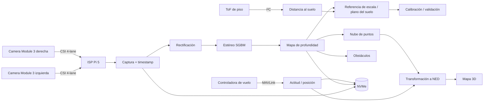

# Diseño de visión: estéreo + ToF de piso

> Estado: Borrador · Versión: 0.1 · Revisión: 2026-11-21 · Responsable: rol de Visión

## 1. Propósito y alcance

Diseñar el payload de visión de un dron de inspección/mapeo 3D con:

- Dos **Raspberry Pi Camera Module 3 Standard** (Sony IMX708, 12 MP, rolling
  shutter, autofocus) montadas en un par estéreo con baseline nominal de
  **150 mm**.
- Un **ToF de piso TFmini Plus 12 m** (base para 6 m), con VL53L1X o VL53L5CX
  8×8 (≤4 m) como alternativas de banco, montado en la base y mirando al suelo.
- Una **Raspberry Pi 5 8 GB** con doble CSI, ISP, PCIe y Ubuntu 24.04 /
  Raspberry Pi OS.
- Un pipeline de rectificación, disparidad, profundidad, nube de puntos,
  referencia de calibración con ToF de piso y detección de obstáculos.

Fuera de alcance: control de vuelo, planificación de trayectoria, georreferencia
RTK, certificación aeronáutica y operación BVLOS.

> **Supuesto:** la controladora de vuelo entrega actitud y, si existe,
> posición local por MAVLink. Si no entrega posición, la nube de puntos queda en
> el frame de la cámara y no se puede georreferenciar; se registra la limitación.

## 2. Arquitectura de percepción



## 3. Aclaración: geometría epipolar vs. ToF

La **geometría epipolar** es una propiedad del par estéreo calibrado. Para un
punto 3D \(X\), sus proyecciones \(x_1\) y \(x_2\) satisfacen:

\[
x_2^\top F x_1 = 0, \qquad E = K_2^\top F K_1
\]

donde \(F\) es la matriz fundamental, \(E\) la esencial y \(K_1, K_2\) las
matrices intrínsecas. La rectificación transforma las imágenes para que las
líneas epipolares sean horizontales; así la búsqueda de correspondencias se
reduce a una dimensión (disparidad horizontal). **Todo esto sale de las dos
cámaras, no del ToF.**

El **ToF de piso** es un sensor independiente, con su propio eje y su propio
FoV. No define líneas epipolares ni participa en la matriz fundamental. Su papel
es:

1. **Medir la distancia vertical cámara–suelo** (altitud bajo la cámara).
2. **Anclar la escala** del plano del suelo y validar la homografía
   suelo→imagen.
3. **Validar** la profundidad del estéreo en el centro y en las zonas donde el
   piso es visible.
4. **Estimar la extrínseca ToF–cámara** y el plano del suelo (normal y altura).

Un estéreo calibrado con baseline conocida **ya es métrico**; el ToF no le
“da” la escala. Lo que hace es verificarla de forma independiente y aportar el
plano del suelo/altitud. Una sola distancia **no** sustituye la calibración
intrínseca ni la estéreo: la calibración con tablero sigue siendo obligatoria; el
ToF añade una **restricción métrica** y una verificación.

> Si el objetivo fuera **estéreo activo** (proyectar textura para mejorar la
> correspondencia), haría falta un proyector de patrón (láser o DLP), no un ToF.
> Si el objetivo es **medir la profundidad de la escena**, el estéreo es la
> fuente; el ToF de piso mide el suelo, no la fachada. Si el objetivo es **medir
> la distancia al piso**, el ToF es el sensor adecuado.

## 4. Geometría estéreo

### 4.1 Parámetros

| Parámetro | Valor | Fuente |
|---|---:|---|
| Sensor | Sony IMX708, 4608 × 2592 | F-02 |
| Tamaño de píxel | 1,4 µm × 1,4 µm | F-02 |
| Focal | 4,74 mm | F-02 |
| FoV horizontal (Standard) | 66° | F-02 |
| FoV vertical (Standard) | 41° | F-02 |
| Baseline nominal | 150 mm (100–200 mm ajustable) | Diseño |
| Resolución de captura | 2304 × 1296 (2×2 binning) | Diseño |
| Resolución de proceso | 1152 × 648 o 640 × 360 | Diseño |
| Focal en píxeles (2304) | \(f_{px} = 4{,}74 / 0{,}0014 \approx 3386\) | Cálculo |
| Focal en píxeles (2×2) | \(f_{px} \approx 1693\) | Cálculo |
| Rango de disparidad inicial | 0–256 px | Diseño |

### 4.2 Ecuaciones

Para un par rectificado:

\[
Z = \frac{f_{px}\, b}{d}, \qquad
\Delta Z \approx \frac{Z^2}{f_{px}\, b}\,\sigma_d
\]

donde \(Z\) es la profundidad, \(b\) la baseline, \(d\) la disparidad en píxeles
y \(\sigma_d\) el error de disparidad (se asume 0,5 px para el análisis).

Con \(b = 0{,}150\) m y \(f_{px} = 1693\):

\[
f_{px} b = 253{,}9\ \text{px·m}
\]

| Profundidad \(Z\) | Disparidad \(d\) | Error \(\Delta Z\) con \(\sigma_d=0{,}5\) px |
|---:|---:|---:|
| 1 m | 254 px | 0,2 cm |
| 2 m | 127 px | 0,8 cm |
| 3 m | 85 px | 1,8 cm |
| 5 m | 51 px | 4,9 cm |
| 6 m | 42 px | 7,1 cm |
| 8 m | 32 px | 12,6 cm |
| 10 m | 25 px | 19,7 cm |
| 15 m | 17 px | 44,3 cm |

> **Lectura:** el estéreo es muy preciso hasta 5 m; a 10 m el error es ~20 cm;
> a 15 m deja de ser útil para inspección fina. Para mejorar el rango lejano,
> aumentar la baseline a 200 mm o usar una cámara de mayor focal. Para mejorar
> el rango cercano (<1 m), reducir la baseline o aumentar el rango de
> disparidad. El ToF de piso **no** sustituye esa medida: da altura, no la
> profundidad de la escena.

### 4.3 Rango y búsqueda de disparidad

Con 256 disparidades a 2304 × 1296, la profundidad mínima teórica es:

\[
Z_{min} = \frac{f_{px} b}{d_{max}} = \frac{253{,}9}{256} \approx 0{,}99\ \text{m}
\]

Por eso el modo estéreo principal opera desde **~1 m**. El **ToF de piso** no
cubre la escena: mide la altura bajo la cámara. La base es **TFmini Plus 12 m**
(0,1–12 m), porque la competencia vuela a **6 m**; el VL53L1X/VL53L5CX (0,1–4 m)
no alcanzan. Para medir a 0,5 m con estéreo se puede:

- duplicar el rango de disparidad (512 px), con más coste de CPU;
- procesar a 1152 × 648 con 256 disparidades (\(Z_{min} \approx 0{,}50\) m);
- reducir la baseline a 75 mm, aceptando menos precisión lejana.

La configuración inicial prioriza **1–10 m** para la escena. El corto alcance
(<1 m) se resuelve con el ToF de piso solo para la altura, no para la geometría
de la escena.

### 4.4 Campo de visión

Con 66° horizontales, el ancho visible es:

| Distancia | Ancho aproximado |
|---:|---:|
| 1 m | 1,30 m |
| 2 m | 2,60 m |
| 5 m | 6,50 m |
| 10 m | 13,0 m |

La resolución angular es \(66°/2304 \approx 0{,}029°/\text{px}\), es decir
~2,5 mm/px a 5 m y ~5 mm/px a 10 m. La nube de puntos se reduce a vóxeles de
5 cm para el mapa; no se promete precisión milimétrica.

## 5. Calibración

### 5.1 Intrínseca

- Tablero ChArUco (7×5, cuadros de 30 mm, marcadores de 22 mm) o checkerboard
  9×6 de 25 mm.
- 15–25 imágenes por cámara, cubriendo centro, bordes, inclinaciones y
  distancias de 0,5–5 m.
- `cv2.calibrateCamera` con modelo Brown-Conrady; error de reproyección
  objetivo **< 0,5 px**.
- Guardar `K`, `D`, resolución, fecha, temperatura y posición de foco.

### 5.2 Estéreo

- 20–30 pares simultáneos del tablero, con las dos cámaras viendo el patrón.
- `cv2.stereoCalibrate` con `CALIB_FIX_INTRINSIC` después de calibrar cada
  cámara; obtener `R`, `T`, `E`, `F`.
- `cv2.stereoRectify` y `cv2.initUndistortRectifyMap`; guardar `R1`, `R2`,
  `P1`, `P2`, `Q`.
- Error de reproyección estéreo objetivo **< 0,5 px**.
- Verificar la baseline física con calibrador: \(|T|\) vs 150 mm, tolerancia
  **±1 mm**.
- Verificar la rectificación: la diferencia vertical media de puntos
  correspondientes debe ser **< 0,3 px**.

### 5.3 Foco

La CM3 tiene autofoco por voice-coil. En vuelo, el autofoco puede “cazar” con la
vibración y cambiar la focal efectiva. **Bloquear el foco** antes de calibrar y
de volar:

- `rpicam-apps`: `--autofocus-mode manual --lens-position <valor>`.
- Picamera2: `AfModeEnum.Manual`, `LensPosition`.
- Elegir la posición según la misión:
  - inspección lejana (3–10 m): foco a ~3 m; hiperfocal ~4,5 m con F1.8 y
    criterio de 2 px;
  - inspección cercana (0,5–2 m): foco a ~1 m;
  - no usar autofoco continuo en vuelo.
- Verificar con una carta de resolución y medir la nitidez en los bordes.

### 5.4 Deriva térmica y mecánica

- Calibrar a temperatura ambiente y repetir después de 10 min de operación.
- Si el error de rectificación cambia > 0,2 px o la baseline cambia > 0,5 mm,
  revisar el montaje.
- No calibrar con las cámaras colgando de cables: la barra debe estar montada y
  atornillada.
- Guardar la calibración en YAML con hash; no editar a mano después de volar.

## 6. Pipeline

### 6.1 Captura

- Picamera2 con dos cámaras (`Picamera2(0)`, `Picamera2(1)`), modo
  2304 × 1296 @ 10–15 fps o 1280 × 720 @ 30 fps.
- Timestamp del sensor (`SensorTimestamp`) y del host; se registra la diferencia.
- Exposición y ganancia fijas durante un experimento; si se usa autoexposición,
  bloquearla después de 1–2 s para que las dos cámaras converjan.
- Balance de blancos fijo; las dos cámaras deben tener el mismo tratamiento.
- Deshabilitar WiFi/Bluetooth en vuelo si interfieren con la radio.

> **Sincronización:** la Pi 5 puede capturar de las dos CSI, pero la CM3 no
> tiene conector de genlock. La captura es “casi simultánea” por software. En
> movimiento rápido hay skew por rolling shutter. Mitigaciones: vuelo lento,
> exposición corta (< 2 ms), evitar giros rápidos y, para escenas dinámicas,
> usar cámaras global shutter (alternativa).

### 6.2 Rectificación y estéreo

- Rectificar a 2304 × 1296 con los mapas de calibración.
- Convertir a gris y reducir a 1152 × 648 para SGBM.
- Parámetros iniciales:

```yaml
stereo:
  num_disparities: 256
  block_size: 5
  min_disparity: 0
  uniqueness_ratio: 10
  speckle_window_size: 100
  speckle_range: 2
  disp12_max_diff: 1
  pre_filter_cap: 63
  mode: SGBM_3WAY
```

- Filtro WLS (`cv2.ximgproc.createDisparityWLSFilter`) si está disponible;
  si no, filtro mediana y eliminación de outliers por consistencia
  izquierda-derecha.
- Profundidad \(Z = Q \cdot d\); convertir a `float32` en metros.
- Máscara de validez: disparidad > 0, pendiente local < umbral, consistencia
  izquierda-derecha, y \(Z\) dentro de 0,3–20 m.

### 6.3 Nube de puntos

- `cv2.reprojectImageTo3D` con `Q`; color desde la imagen izquierda.
- Filtrar por distancia y por validez; voxel de 5 cm para el mapa.
- Statistical Outlier Removal (SOR) con 20 vecinos y 1,5σ.
- Guardar en `PCD`/`PLY`; registrar el frame (`camera_left`, `base_link`,
  `map`).

### 6.4 ToF de piso: altitud, plano del suelo y calibración

- **Montaje:** **TFmini Plus** en la base del payload, mirando al piso, con el
  eje lo más paralelo posible a la vertical y cerca del centro de la baseline.
  Medir el offset mecánico ToF→cámara con CAD/calibrador y guardarlo en el YAML.
- **Lectura:** TFmini Plus a 100 Hz (usar 15–50 Hz), un punto, 12 m, haz
  estrecho (~2°). Alternativas ≤4 m: VL53L1X (1 punto) o VL53L5CX (8×8).
- **Distancia:** si el piso es plano y el eje es vertical,
  \(d_{tof} \approx h - \Delta z\), con \(h\) la altura de la cámara y
  \(\Delta z\) el offset vertical del ToF. Si hay inclinación, el plano se
  escribe \(n^\top X = d_p\), con \(n\) la normal del piso en el frame de la
  cámara y \(d_p\) la distancia perpendicular.
- **Plano del suelo:** si el piso es visible en la imagen, la homografía
  \(H = K [r_1\ r_2\ t]\) relaciona el plano con la imagen. El ToF fija la
  escala \(d_p\), lo que permite estimar \(t = d_p n\) y la rotación
  cámara→piso. Usar una alfombra o tablero texturado para que la homografía
  esté bien condicionada.
- **Chequeo de escala:** un objeto de tamaño conocido \(S\) sobre el piso a
  distancia \(d_{tof}\) cumple \(s_{px} \approx f_{px} S / d_{tof}\). Comparar
  \(f_{px}\) con el valor calibrado; si el error es >2 %, revisar foco,
  calibración o distancia.
- **Validación del estéreo:** proyectar el punto del ToF al píxel
  correspondiente y comparar \(d_{tof}\) con la mediana de \(Z_{stereo}\) en una
  ventana de 5 × 5 px. Si el sesgo es > \(\max(5\ \text{cm}, 2\%)\), revisar
  baseline, focal y extrínseca. En el píxel central, con disparidad \(d\), se
  cumple \(f_{px} b \approx Z_{tof} d\); si el producto se desvía >2 %, la
  escala del estéreo no está bien calibrada. Descartar la comparación si el piso
  no está en la ventana o la disparidad es inválida.
- **Extrínseca ToF–cámara:** colocar un tablero plano en el piso a varias
  distancias (0,5, 1, 2, 3, 4 m). Estimar la pose del plano en la cámara con el
  tablero; el ToF da la distancia a lo largo de su eje. Resolver la transformación
  rígida \(T_{tof}^{cam}\) (mano-ojo con plano). Si el ToF es paralelo al eje
  óptico y el tablero es perpendicular, la transformación es casi una
  translación; si no, resolver 6 grados de libertad. Validar proyectando el spot
  del ToF en la imagen: residual <5 px.
- **Haz y superficie:** el VL53L1X tiene un cono de 27°; a 2 m el spot mide
  ~0,96 m y devuelve la superficie más cercana del cono. En un piso inclinado o
  con objetos, el valor se sesga. Usar una superficie plana y mate para calibrar;
  para un piso irregular, usar el VL53L5CX y ajustar un plano con RANSAC. El
  TFmini Plus tiene un haz mucho más estrecho y 12 m, mejor para un spot preciso.
- **Alcance:** TFmini Plus = 12 m; VL53L1X/VL53L5CX = 4 m. La competencia vuela
  a **6 m**, así que la base es TFmini Plus. A 6 m el spot del TFmini mide
  ~21 cm y el margen al límite de 12 m es amplio. El VL53L1X/8×8 saturan a 4 m
  y **no sirven para esta misión** salvo en banco. El barómetro/FC da altitud,
  pero no la precisión necesaria para calibrar.
- **Procedimiento de calibración con ToF:**
  1. Montar el ToF y medir el offset.
  2. Poner un tablero plano y mate en el piso, perpendicular a la vertical.
  3. Capturar a 0,5, 1, 2, 3, 4 y **6 m**; registrar ToF, imágenes y
     temperatura.
  4. Calibrar intrínseca y estéreo con el tablero (el ToF no las sustituye).
  5. Estimar la homografía del piso y usar el ToF para fijar la escala.
  6. Resolver la extrínseca ToF–cámara y validar el spot.
  7. Comparar \(d_{tof}\) con \(Z_{stereo}\) en el centro y en varias distancias.
  8. Repetir después de 10 min de operación para medir deriva térmica.

**Orientación de las cámaras:**

| Configuración | Cámaras | ToF | Uso del ToF |
|---|---|---|---|
| **A — mapeo del suelo** | Mirando abajo/oblicuo | Abajo | Referencia directa del plano del suelo; escala y calibración |
| **B — inspección frontal** | Mirando al frente | Abajo | Altitud; la referencia de escala solo sirve si el piso es visible en la imagen |

> En la configuración B, el ToF **no** mide la distancia a la fachada. Para
> escalar una fachada hacen falta un objeto de tamaño conocido, un tablero o una
> segunda referencia; el ToF de piso solo da altitud. En la jaula a 6 m, la
> configuración A (cámaras al piso) es la que aprovecha directamente la
> referencia.

> **Limitación:** una sola distancia no permite calibrar los intrínsecos. La
> calibración con tablero en varias orientaciones sigue siendo obligatoria. El
> ToF es una restricción métrica y una verificación independiente.

### 6.5 Pose y georreferencia

- MAVLink: `ATTITUDE` (quaternion), `LOCAL_POSITION_NED`, `GPS_RAW_INT`,
  `TIMESYNC`.
- Transformar cámara → cuerpo → NED con la extrínseca de montaje.
- Si no hay posición local, usar solo actitud y acumular en un frame local de
  cámara; marcar la nube como “no georreferenciada”.
- Sincronizar timestamps; si la diferencia es > 20 ms, interpolar o descartar.
- **Altura y plano del suelo:** usar el ToF de piso para estimar la altura y la
  normal del piso; fusionar con la actitud de la IMU y, si existe, con el
  barómetro. Si la diferencia de altura es >5 cm, revisar el offset, la
  calibración o la superficie.
- Para mayor precisión, evaluar VIO con una IMU rígida a la cámara (fuera de la
  BOM base).

### 6.6 Mapa y detección de obstáculos

- Keyframes cada 0,3 m o 1 s; acumular nubes; voxel 5 cm; ICP opcional para
  cierre de lazo.
- Obstáculos: rejilla de profundidad del **estéreo**, distancia mínima por
  celda, publicar `Obstacle` y, si la FC lo soporta, `OBSTACLE_DISTANCE` por
  MAVLink. El ToF de piso **no** se usa para obstáculos frontales; en la
  configuración B se puede añadir un ToF frontal opcional, pero no está en la
  BOM base.
- La visión es **advisory**: la FC y el piloto conservan la autoridad. No
  enviar comandos de velocidad ni de actitud desde este payload.

### 6.7 Registro

- NVMe: frames izquierdo/derecho comprimidos (JPEG calidad 90) o raw para
  calibración; profundidad 16-bit PNG; `tof_floor.csv` (distancia, zona, estado,
  timestamp); `ground_plane.yaml` (normal, altura, RMS); pose CSV; calibración
  YAML; logs.
- 30 min a 10 fps con JPEG + profundidad 16-bit: ~20–40 GB; 128 GB da margen
  para ~1–2 h según configuración.
- Registrar hash de la sesión y versión del código.

## 7. Energía y térmica

| Elemento | Consumo típico | Pico |
|---|---:|---:|
| Raspberry Pi 5 8 GB | 5–10 W | 25 W |
| SSD NVMe | 2–3 W | 4 W |
| 2 × CM3 + cables | 0,6 W | 1 W |
| ToF | 0,3–0,5 W | 0,5 W |
| Active Cooler | 0,5 W | 1 W |
| **Total** | **~9–15 W** | **~31 W** |

- UBEC 5 V/5 A (25 W continuos) es el mínimo; el Matek BEC12S-PRO declara 5 A
  continuos y 9 A pico. El pico conjunto de ~31 W (6,2 A) dura menos de 1 s y
  cabe en los 9 A de pico; en continuo, 12–16 W (2,4–3,2 A) están dentro de los
  5 A. Si se añaden periféricos, usar un UBEC de 5 V/8 A.
- Medir la tensión en el conector de la Pi 5 bajo carga; debe mantenerse
  > 4,9 V. Si cae, acortar cables, subir a 5,2 V o usar un UBEC mayor.
- Fusible de 5 A; capacitor de 1000 µF; masa común en estrella.
- Active Cooler y ventilación de la caja; sin ventilación, la Pi 5 throttlea.
- Monitorizar `vcgencmd measure_temp` y `vcgencmd get_throttled`; objetivo
  < 80 °C y `0x0`.

## 8. Mecánica y vibración

| Elemento | Masa estimada |
|---|---:|
| Pi 5 8 GB | 50 g |
| HAT+ M.2 + SSD | 30 g |
| Active Cooler | 35 g |
| 2 × CM3 + cables | 20 g |
| ToF TFmini Plus + cable | 15 g |
| UBEC + cableado | 30 g |
| Barra, soportes y bandeja | 80 g |
| Tornillería y aisladores | 20 g |
| **Total** | **~280 g** |
| **Límite de diseño** | **350 g** |

- Barra rígida de 150 mm entre centros de lente; aluminio 2020, tubo de carbono
  o PETG/PA-CF grueso. No usar una barra fina impresa.
- Cámaras paralelas, sin toe-in; la calibración corrige pequeñas desviaciones,
  pero la deriva mecánica no.
- Aisladores de silicona M3 en 4 puntos; no rígidizar la Pi contra la barra de
  las cámaras.
- Montar cerca del centro de gravedad; verificar que el dron compensa el peso.
- Proteger las lentes con un parasol o carcasa ventilada; no cubrir el sensor.
- Evitar que el cable FPC transmita vibración a la cámara; fijarlo con espuma.
- **ToF de piso:** montarlo en la base con una ventana/abertura y un parasol;
  el eje debe ser lo más vertical posible y el offset a la cámara debe estar
  medido. No montarlo sobre una tapa que flexe ni cerca del flujo de una hélice
  que arrastre polvo.

## 9. Rendimiento esperado (hipótesis a medir)

| Modo | Resolución | Frecuencia objetivo | Uso |
|---|---|---:|---|
| Captura | 2304 × 1296 | 10–15 fps | Registro y calibración |
| Estéreo rápido | 640 × 360 | ≥ 15 fps | Obstáculos |
| Estéreo denso | 1152 × 648 | ≥ 5 fps | Mapa |
| ToF de piso | TFmini Plus 1 punto, 12 m | 15–100 Hz | Altitud / plano del suelo |
| Nube | voxel 5 cm | 2–5 Hz | Mapa |

> **No son cifras medidas.** La Pi 5 no tiene GPU CUDA; SGBM corre en CPU. El
> rendimiento real se mide en TC-06/TC-09 y se registra en evidencia. Si no se
> alcanza, reducir resolución, aumentar `block_size` o usar BM en lugar de SGBM.

## 10. Riesgos y mitigaciones

| Riesgo | Efecto | Mitigación |
|---|---|---|
| Rolling shutter | Bordes deformados en movimiento | Vuelo lento, exposición corta; GS como alternativa |
| Falta de genlock | Skew entre izquierda/derecha | Captura casi simultánea; evitar giros; GS con sync |
| Autofoco | Foco variable y calibración inválida | Bloquear foco; verificar carta |
| Vibración | Borrosidad y deriva de baseline | Aisladores, barra rígida, balance de hélices |
| Calor | Throttling y reinicios | Active Cooler, caja ventilada, límite de CPU |
| Brownout | Reinicio en vuelo | UBEC 5 A, fusible, capacitor, cables cortos |
| WiFi/BT | Interferencia con RC | Deshabilitar en vuelo; probar en tierra |
| Textura escasa | Disparidad inválida | Luz/patrón; marcar inválido; el ToF de piso no rellena la escena |
| Sol/IR | ToF satura o mide mal | Superficie mate; no confiar solo en ToF; rango 4 m; TFmini Plus |
| TFmini falla a 6 m | No mide altura | Barómetro/FC; validar rango y estado |
| Piso inclinado/irregular | Distancia sesgada | Superficie plana para calibrar; 8×8 + RANSAC si se usa |
| Jaula sin GPS | Nube sin georreferencia | Posición local/optical flow de la FC; frame local (OQ-12) |
| Luz artificial | Flicker/bandas | Anti-flicker 50 Hz; exposición fija; validar imágenes |
| Peso/CG | Autonomía y estabilidad | Pesar, montar cerca del CG, volar con margen |

## 11. Protocolo de puesta a punto

1. **Banco, sin hélices:** verificar cámaras, foco, exposición, captura dual,
   timestamps y **ToF de piso** (0,5–6 m).
2. **Calibración:** intrínseca, estéreo, baseline; guardar YAML y hash.
3. **Plano del suelo y extrínseca ToF–cámara:** tablero plano a 0,5, 1, 2, 3 y
   4 m; homografía, altura, normal y `T_tof_cam`; guardar YAML.
4. **Validación estática:** tablero a 1, 2, 3, 5, 8 y 10 m; comparar con cinta
   métrica y, en el piso, con el ToF.
5. **Nube de puntos:** escanear una maqueta; verificar escala y color.
6. **Térmica:** 20 min a carga máxima; registrar temperatura y throttling.
7. **Vibración:** dron con hélices puestas y amarrado; medir blur y deriva.
8. **Vuelo cautivo:** baja altura, geofence, spotter; registrar pose, altura y
   nube.
9. **Vuelo libre:** solo con autorización y seguro; repetir 10 veces.

## 12. Parámetros iniciales (YAML)

```yaml
calibration:
  image_size: [2304, 1296]
  baseline_mm: 150.0
  rms_stereo_px: 0.5
  focus_position: 3.0          # metros; bloqueado
  camera_matrix_left: [[1693.0, 0.0, 1152.0],
                       [0.0, 1693.0, 648.0],
                       [0.0, 0.0, 1.0]]
  camera_matrix_right: [[1693.0, 0.0, 1152.0],
                        [0.0, 1693.0, 648.0],
                        [0.0, 0.0, 1.0]]
  # Distorsión, R, T, R1, R2, P1, P2, Q: se cargan del archivo calibrado.

stereo:
  num_disparities: 256
  block_size: 5
  min_disparity: 0
  uniqueness_ratio: 10
  speckle_window_size: 100
  speckle_range: 2
  disp12_max_diff: 1
  pre_filter_cap: 63
  mode: SGBM_3WAY

tof:
  model: tfmini_plus           # vl53l1x / vl53l5cx solo para ≤4 m
  mount: downward
  range_m: 12.0
  interface: uart              # UART o I²C
  rate_hz: 50
  extrinsic:                   # ToF -> cámara izquierda
    translation_m: [0.0, 0.0, 0.0]
    rotation_rpy_deg: [0.0, 0.0, 0.0]

ground_reference:
  max_delta_m: 0.05
  max_delta_ratio: 0.02
  plane_rms_m: 0.02

recording:
  image_format: jpeg
  jpeg_quality: 90
  depth_format: png16
  pose_csv: true
  tof_floor_csv: true
  ground_plane_yaml: true
```

> Los valores de `camera_matrix` son ilustrativos; se reemplazan por la
> calibración real. No usar este YAML para volar sin calibrar.

## 13. Referencias

- Raspberry Pi Camera Module 3, especificaciones: `F-02`, `F-03`.
- Raspberry Pi 5, doble CSI y software de cámara: `F-01`, `F-04`.
- ST VL53L1X / VL53L5CX: `F-13`, `F-14`, `F-15`, `F-16`.
- OpenCV calibración estéreo: `F-23`.
- MAVLink: `F-24`.
- Picamera2: `F-25`.
