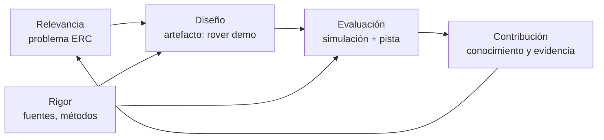

# Metodología del proyecto

> Estado: Borrador · Versión: 0.1 · Revisión: 2026-11-21 · Responsable: rol de Gestión de Proyecto

## 1. Propósito

Definir **cómo se trabaja** en este proyecto: qué fases existen, qué artefactos se producen, cómo se toman las decisiones, cómo se verifica el trabajo y cómo se demuestra que algo está terminado. La metodología debe ser lo bastante rigurosa para un jurado técnico y lo bastante ligera para un equipo pequeño.

## 2. Enfoque: SDLC iterativo + Design Science Research

Combinamos dos marcos complementarios:

| Marco | Aporta | Se aplica en |
|---|---|---|
| **SDLC iterativo e incremental** (inspirado en ISO/IEC 12207) | Fases, puertas, trazabilidad, configuración, verificación | Todo el ciclo |
| **Design Science Research (DSR)** (Hevner et al., 2004) | Rigor, relevancia, evaluación del artefacto, contribución de conocimiento | Investigación y validación |
| **Ingeniería de requisitos** (inspirada en IEEE 29148) | Requisitos verificables, priorización, criterios de aceptación | Fase 02 |
| **Gestión de riesgos** (inspirada en ISO 31000) | Identificación, evaluación, tratamiento y seguimiento | Transversal |
| **Pruebas por niveles** (inspirada en ISO/IEC/IEEE 29119) | Unitarias, integración, sistema, aceptación | Fase 06 |

### Ciclo DSR aplicado

- **Relevancia:** el problema no es académico; es navegar de forma autónoma y segura en un entorno tipo Marte, con recursos limitados.
- **Diseño:** el artefacto es el sistema completo (hardware + software + documentación + evidencia), no solo el código.
- **Evaluación:** experimentos reproducibles con métricas definidas (éxito, error de posición, tiempo, CPU, consumo).
- **Rigor:** cada decisión se apoya en fuentes o en experimentos; los supuestos se declaran.
- **Contribución:** el equipo aprende y deja un método reutilizable para el rover grande.

## 3. Fases y puertas

| Fase | Entradas | Actividades | Salidas | Puerta |
|---|---|---|---|---|
| 0. Concepción | Necesidad, contexto ERC | Investigación documental, benchmarking, alcance | Visión, contexto, riesgos iniciales | **G0** |
| 1. Requisitos | Visión aprobada | Elicitación, análisis, priorización, criterios | RF, RNF, historias, trazabilidad | **G1** |
| 2. Arquitectura y diseño | Requisitos | Arquitectura, interfaces, ADRs, diseño detallado | Diagramas, ADRs, BOM, diseño | **G2** |
| 3. Implementación | Diseño aprobado | Codificación, configuración, unit tests | Incremento ejecutable | **G3** |
| 4. Verificación y validación | Incremento | Pruebas de integración, sistema, aceptación | Resultados, evidencia, desviaciones | **G4** |
| 5. Operación y demo | Sistema validado | Despliegue, preflight, ensayos, presentación | Runbook, evidencia final, guion | **G5** |

### Criterios de las puertas

#### G0 — Concepción

- [ ] Problema y alcance escritos y acotados.
- [ ] Contexto ERC verificado con fuentes oficiales.
- [ ] Al menos una alternativa tecnológica comparada.
- [ ] Riesgos principales identificados.
- [ ] El usuario aprueba el alcance.

#### G1 — Requisitos

- [ ] Cada requisito tiene ID, prioridad y criterio de aceptación verificable.
- [ ] Requisitos funcionales y no funcionales separados.
- [ ] Trazabilidad inicial requisito → prueba.
- [ ] No hay requisitos ambiguos (“rápido”, “fácil”) sin métrica.

#### G2 — Arquitectura y diseño

- [ ] Arquitectura de componentes, interfaces y despliegue.
- [ ] ADRs para decisiones estructurales.
- [ ] Interfaces de datos versionadas (topics, acciones, YAML).
- [ ] Análisis de seguridad y FMEA inicial.
- [ ] Revisión por pares sin bloqueantes.

#### G3 — Implementación

- [ ] Build reproducible en el entorno objetivo.
- [ ] Pruebas unitarias en verde.
- [ ] Lint y validación de sintaxis sin errores.
- [ ] Documentación de instalación actualizada.
- [ ] Sin secretos ni artefactos generados versionados.

#### G4 — Verificación y validación

- [ ] Casos de prueba ejecutados y registrados.
- [ ] Métricas comparadas con los umbrales de los RNF.
- [ ] Evidencia con metadatos, logs y hash.
- [ ] Desviaciones documentadas y aceptadas por el responsable.
- [ ] Regresión ejecutada tras correcciones.

#### G5 — Operación y demo

- [ ] Runbook y preflight probados.
- [ ] Ensayo completo con tiempo real.
- [ ] Contingencias definidas (fallo de red, batería, localización, sensor).
- [ ] Evidencia final y guion de presentación.
- [ ] Revisión de seguridad antes de operar con público.

## 4. Cadencia de trabajo

El proyecto no tiene fecha fija de ERC 2027, así que se planifica por **sprints de 2 semanas** y **hitos relativos** (T0 = 2026-11-21).

| Ritual | Frecuencia | Salida |
|---|---|---|
| Planificación de sprint | Cada 2 semanas | Objetivo, backlog priorizado, riesgos |
| Daily / async | Diario | Bloqueos y avances |
| Revisión de sprint | Cada 2 semanas | Demo, evidencia, aceptación |
| Retrospectiva | Cada 2 semanas | Acciones de mejora |
| Revisión de puerta | Al cerrar fase | Checklist G0–G5 firmado |
| Revisión de riesgos | Mensual | Registro actualizado |

### Regla de tiempo para spikes

Un *spike* (investigación técnica exploratoria) tiene:

- Una pregunta concreta.
- Un tiempo máximo (por defecto 4 horas, máximo 1 día).
- Una conclusión escrita, aunque sea “no funciona”.
- Ningún compromiso de producto hasta pasar G4.

## 5. Gestión de cambios

### Cambio de requisito

1. Solicitud en la bitácora con motivo.
2. Análisis de impacto (diseño, pruebas, presupuesto, calendario).
3. Aprobación del responsable de producto.
4. Actualización de requisito, trazabilidad y casos de prueba.
5. Registro en `CHANGELOG.md`.

### Cambio arquitectónico

1. Nuevo ADR con contexto, alternativas, decisión y consecuencias.
2. Revisión técnica.
3. Si reemplaza un ADR anterior, se marca como `Reemplazado por ADR-XXXX` (nunca se borra).
4. Actualización de interfaces y diagramas.

### Cambio de código

1. Rama corta desde `main`.
2. Commits pequeños con Conventional Commits.
3. `make check` antes de abrir revisión.
4. Revisión por pares (aunque sea informal) para cambios de navegación, seguridad o interfaces.
5. Merge con historial lineal o squash, según preferencia del equipo.

## 6. Configuración y reproducibilidad

- **Versiones fijadas:** distro ROS 2, versión de Gazebo, versión de Python, imagen de Ubuntu.
- **Entorno declarado:** `docs/05-implementacion/entorno-desarrollo.md`.
- **Build reproducible:** `colcon build --symlink-install`, dependencias vía `rosdep`.
- **Assets deterministas:** mundo y mapa generados desde `arena.json` con un script versionado.
- **Evidencia:** cada ejecución guarda commit, host, versiones, comando y hashes.

## 7. Métricas del proyecto

| Métrica | Objetivo | Cómo se mide |
|---|---|---|
| Cobertura de trazabilidad | 100% de RF/RNF con prueba asociada | `scripts/docs/check_docs.py` |
| Requisitos verificables | 100% con criterio medible | Revisión G1 |
| Pruebas unitarias | 100% en verde | `make test` |
| Tasa de éxito de misión | ≥ 80% en 10 ensayos | Protocolo de experimentos |
| Error de posición final | ≤ 0.30 m | Comparación con ground truth |
| Documentos con enlaces válidos | 100% | `make docs` |
| Riesgos con mitigación | 100% de riesgos altos | Registro de riesgos |
| Evidencia por hito | ≥ 1 carpeta sellada | Registro de evidencias |

## 8. Herramientas

| Área | Herramienta | Nota |
|---|---|---|
| Documentación | Markdown + Mermaid + Git | Sin dependencias propietarias |
| Validación documental | `scripts/docs/check_docs.py` | Enlaces, IDs, trazabilidad |
| Assets | `scripts/docs/generate_arena.py` | SDF + PGM deterministas |
| Pruebas | `unittest` (Python estándar) | Sin pytest en el host base |
| ROS 2 | `colcon`, `ros2 launch`, `rosbag2` | Ubuntu 24.04 |
| Simulación | Gazebo Harmonic + `ros_gz` | ROS 2 Jazzy |
| Navegación | Nav2 | AMCL + Navfn + RPP |
| Evidencia | Scripts propios + SHA-256 | `scripts/evidence/` |

## 9. Referencias metodológicas

- ISO/IEC/IEEE 12207:2017 — Software life cycle processes.
- ISO/IEC/IEEE 29148:2018 — Requirements engineering.
- ISO/IEC/IEEE 29119 — Software testing.
- ISO 31000:2018 — Risk management.
- Hevner, A. R., et al. (2004). *Design Science in Information Systems Research*. MIS Quarterly, 28(1), 75–105.
- Wieringa, R. J. (2014). *Design Science Methodology for Information Systems and Software Engineering*. Springer.

Las fuentes concretas del dominio ERC/ROS están en [`../01-investigacion/fuentes.md`](../01-investigacion/fuentes.md).
