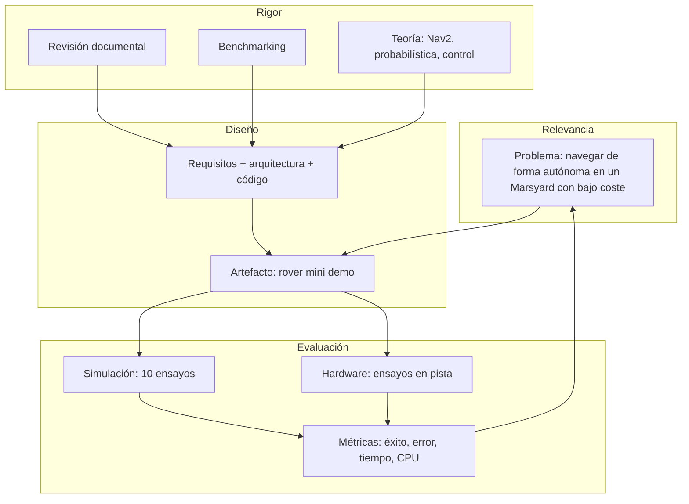

# Marco metodológico de investigación

> Estado: Borrador · Versión: 0.1 · Revisión: 2026-11-21 · Responsable: rol de Investigación

## 1. Enfoque

El proyecto usa **Design Science Research (DSR)** como marco de investigación y un **SDLC iterativo** como marco de ingeniería. La investigación no es un fin en sí misma: alimenta decisiones de diseño y se valida con el artefacto.

## 2. Preguntas de investigación

| ID | Pregunta | Método | Entregable |
|---|---|---|---|
| **RQ1** | ¿Es viable una pila ROS 2 Jazzy + Nav2 sobre Raspberry Pi 4 8 GB para navegación autónoma de un rover de bajo coste? | Benchmarking + experimento en hardware | Informe de viabilidad y métricas |
| **RQ2** | ¿Qué fiabilidad y precisión se obtienen con mapa estático + AMCL + Navfn + RPP en una arena reducida? | Experimento controlado en simulación y pista | Tasa de éxito, error final, tiempos |
| **RQ3** | ¿Qué esfuerzo, coste y riesgos implica llevar esta pila a una demo reproducible? | Estimación, registro de tiempos, riesgos | BOM, plan, lecciones aprendidas |
| **RQ4** | ¿Se degrada la navegación al pasar de simulación a hardware? ¿Cuánto? | Comparación sim vs real con la misma misión | Delta de métricas y causas |

### Preguntas secundarias

- ¿Qué controlador (DWB, MPPI, RPP) ofrece mejor relación fiabilidad/CPU en Pi 4?
- ¿Qué error de odometría es tolerable para AMCL?
- ¿Qué tamaño de arena y resolución de mapa dan un buen compromiso precisión/rendimiento?
- ¿Qué evidencia es más convincente para un jurado técnico?

## 3. Hipótesis

| ID | Hipótesis | Variables | Criterio de aceptación |
|---|---|---|---|
| H1 | La pila Nav2 propuesta completa ≥ 80% de misiones de 5 waypoints en 10 ensayos | Éxito/fallo | ≥ 8/10 |
| H2 | El error de posición final es ≤ 0.30 m | Distancia al waypoint | Media ≤ 0.30 m; p95 ≤ 0.50 m |
| H3 | El Pi 4 8 GB sostiene la pila a 0.4 m/s con CPU < 80% | CPU, RAM, temperatura | Media < 80%, pico < 95% |
| H4 | La degradación sim → real es < 20 puntos porcentuales de éxito | Tasa de éxito | Δ ≤ 20 pp |

Las hipótesis se declaran antes de ejecutar. Si los datos las contradicen, se documenta y se revisa el diseño; no se cambia el criterio a posteriori.

## 4. Métodos

### 4.1 Revisión documental

- **Objetivo:** establecer el estado del arte y los requisitos del ERC.
- **Fuentes primarias:** documentación oficial de ROS 2, Nav2, Gazebo, ERC, fabricantes.
- **Fuentes secundarias:** artículos, blogs técnicos, repositorios, vídeos.
- **Criterios de inclusión:** actualidad (≤ 2 años salvo clásicos), relevancia directa, trazabilidad de la fuente.
- **Criterios de exclusión:** contenido sin autor, datos sin metodología, versiones obsoletas.
- **Registro:** cada fuente se anota en [`fuentes.md`](fuentes.md) con URL, fecha de acceso y confianza.

### 4.2 Benchmarking

- **Objetivo:** comparar plataformas y componentes con criterios explícitos.
- **Criterios:** soporte ROS 2, rendimiento, consumo, precio, disponibilidad, ecosistema, riesgo.
- **Salida:** matriz ponderada y recomendación ([`benchmarking-plataformas.md`](benchmarking-plataformas.md)).

### 4.3 Experimento controlado

- **Objetivo:** medir fiabilidad y precisión de la navegación.
- **Diseño:** misión fija de 5 waypoints, mismo mapa, misma velocidad, 10 repeticiones por entorno (simulación y hardware).
- **Control:** mismas rutas, misma batería inicial (hardware), misma superficie, mismo operador.
- **Medición:** éxito, error final, tiempo, colisiones, intervenciones, CPU, temperatura, consumo.
- **Análisis:** estadística descriptiva, intervalo de confianza de Wilson para proporciones, media/desviación para errores.
- **Detalle:** [`hipotesis-y-experimentos.md`](hipotesis-y-experimentos.md) y [`../06-pruebas/protocolo-experimentos.md`](../06-pruebas/protocolo-experimentos.md).

### 4.4 Estudio de caso

El propio demo es un caso: se documenta el proceso completo (decisiones, fallos, correcciones) para extraer lecciones aplicables al rover grande. La bitácora es la fuente principal.

## 5. Variables

### Independientes

- Entorno: simulación vs hardware.
- Controlador: RPP (base), DWB/MPPI (comparación opcional).
- Velocidad máxima: 0.3, 0.4, 0.5 m/s.
- Resolución del mapa: 0.05 m/px.
- Número de waypoints: 5.
- Calidad de odometría: calibrada vs sin calibrar.

### Dependientes

- Tasa de éxito (misión completa).
- Error de posición final (m).
- Error de orientación final (rad).
- Tiempo de misión (s).
- Número de colisiones.
- Número de intervenciones humanas.
- CPU media y pico (%), RAM (MB), temperatura (°C).
- Consumo energético (Wh).

### Controladas

- Mapa y mundo.
- Posición inicial.
- Lista de waypoints.
- Condiciones de iluminación (simulación).
- Superficie (hardware).
- Versión de software (commit).

## 6. Métricas y umbrales

| Métrica | Unidad | Umbral | Fuente del umbral |
|---|---|---|---|
| Tasa de éxito | % | ≥ 80% | RNF-01 |
| Error final | m | ≤ 0.30 | RNF-02 |
| Error de orientación | rad | ≤ 0.30 | Derivado |
| Velocidad máxima | m/s | ≤ 0.45 | RNF-03 |
| Distancia de parada | m | ≤ 0.30 a 0.3 m/s | RNF-04 |
| Tiempo de arranque | s | ≤ 60 | RNF-05 |
| Autonomía | min | ≥ 30 | RNF-06 |
| CPU | % | ≤ 80 media | RNF-07 |
| RAM | GB | ≤ 6 | RNF-07 |
| Latencia de telemetría | s | ≤ 1 | RNF-13 |
| Cobertura de trazabilidad | % | 100 | Metodología |

## 7. Validez

### Validez interna

- **Operador:** la misma persona ejecuta todas las pruebas para reducir variabilidad.
- **Batería:** se mide y registra el voltaje inicial; se descartan ensayos con batería baja.
- **Superficie:** se barre y marca la pista antes de cada campaña.
- **Software:** se fija el commit y se registra en la evidencia.

### Validez externa

- **Simulación vs realidad:** el mundo es una simplificación; los resultados no se extrapolan sin marcar la diferencia.
- **Arena pequeña:** no representa todo el Marsyard; se documenta el tamaño y las limitaciones.
- **Muestra pequeña:** 10 ensayos dan una estimación exploratoria, no una conclusión estadística fuerte.

### Validez de constructo

- “Éxito” se define operativamente: llegar a todos los waypoints dentro de tolerancia y tiempo, sin colisiones ni intervenciones.
- “Autonomía” se define como N2 en [`contexto-erc.md`](contexto-erc.md).

### Validez de conclusión

- Se reportan intervalos de confianza y no solo medias.
- Se evita afirmar causalidad donde solo hay correlación.
- Los resultados negativos se publican igual que los positivos.

## 8. Ética y seguridad

- Las pruebas con personas requieren consentimiento y anonimización.
- No se graban rostros sin permiso; el vídeo de demo se enfoca en el rover.
- Las pruebas físicas se hacen en zona delimitada, con e-stop y una segunda persona.
- Los datos de los ensayos se guardan sin información personal.

## 9. Artefactos de investigación

| Artefacto | Ubicación |
|---|---|
| Fuentes y notas | [`fuentes.md`](fuentes.md) |
| Estado del arte | [`estado-del-arte.md`](estado-del-arte.md) |
| Benchmarking | [`benchmarking-plataformas.md`](benchmarking-plataformas.md) |
| Hipótesis y experimentos | [`hipotesis-y-experimentos.md`](hipotesis-y-experimentos.md) |
| Protocolo de pruebas | [`../06-pruebas/protocolo-experimentos.md`](../06-pruebas/protocolo-experimentos.md) |
| Resultados | [`../06-pruebas/resultados/`](../06-pruebas/resultados/) |
| Evidencia | [`../08-evidencia/`](../08-evidencia/) |

## 10. Referencias metodológicas

- Hevner, A. R., March, S. T., Park, J., & Ram, S. (2004). Design Science in Information Systems Research. *MIS Quarterly*, 28(1), 75–105.
- Wieringa, R. J. (2014). *Design Science Methodology for Information Systems and Software Engineering*. Springer.
- Creswell, J. W. (2014). *Research Design: Qualitative, Quantitative, and Mixed Methods Approaches*. SAGE.
- ISO/IEC/IEEE 29119-1:2022 — Software testing.
