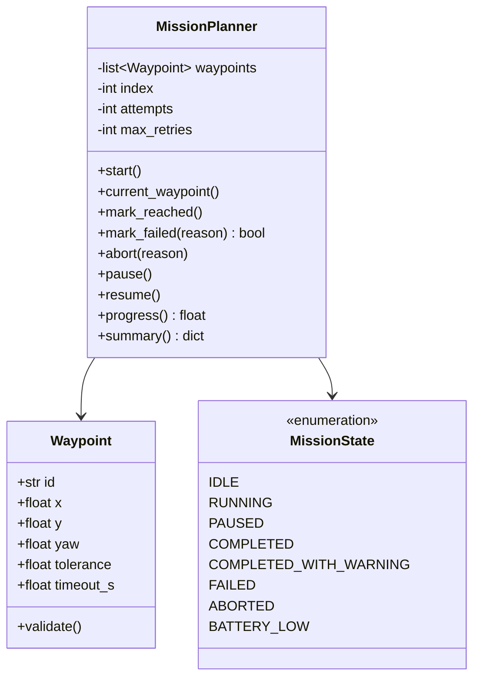
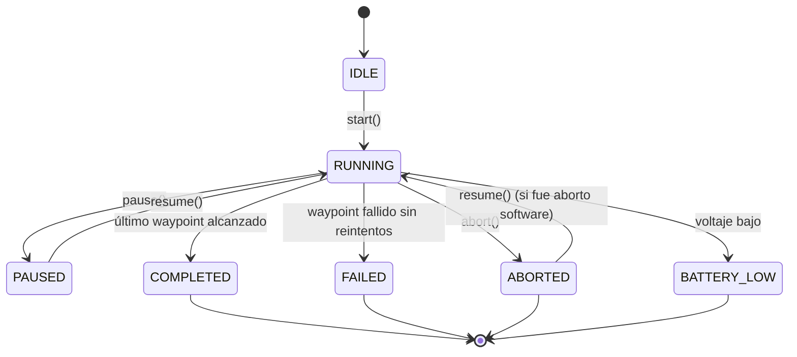

# Diseño de software

> Estado: Borrador · Versión: 0.1 · Revisión: 2026-11-21 · Responsable: rol de Software

## 1. Estructura del workspace

```text
ros_ws/src/
├── rover_description/          URDF/Xacro
│   ├── urdf/rover.urdf.xacro
│   └── package.xml
├── rover_bringup/              Launch, configuración y assets
│   ├── launch/
│   │   ├── sim.launch.py
│   │   ├── bringup.launch.py
│   │   └── mission.launch.py
│   ├── config/
│   │   ├── nav2_params.yaml
│   │   ├── arena.json
│   │   └── rover.rviz
│   ├── maps/
│   │   ├── mini_marsyard.yaml
│   │   └── mini_marsyard.pgm
│   ├── worlds/
│   │   └── mini_marsyard.sdf
│   └── scripts/odom_tf_broadcaster.py
└── rover_mission/              Lógica y nodo de misión
    ├── rover_mission/
    │   ├── mission_planner.py  Lógica pura (sin ROS)
    │   ├── waypoints.py        Carga y validación de YAML
    │   └── mission_node.py     Nodo ROS 2
    ├── config/waypoints_demo.yaml
    └── test/test_mission_planner.py
```

## 2. Modelo de dominio



### Responsabilidades

| Clase | Responsabilidad | Dependencias |
|---|---|---|
| `Waypoint` | Representar y validar un punto | Solo stdlib |
| `MissionPlanner` | Máquina de estados, progreso, reintentos | `Waypoint`, stdlib |
| `waypoints.py` | Cargar YAML y construir `MissionPlanner` | `yaml`, `MissionPlanner` |
| `mission_node.py` | Integración con ROS 2, acción y servicios | `rclpy`, `nav2_msgs`, `MissionPlanner` |

## 3. Máquina de estados



### Reglas

- `start()` solo es válido desde `IDLE`.
- `mark_reached()` solo es válido desde `RUNNING` o `PAUSED`.
- `mark_failed()` incrementa intentos; si quedan reintentos, permanece en `RUNNING`.
- `abort()` es válido desde cualquier estado no terminal.
- Un estado terminal no vuelve a `RUNNING` salvo `ABORTED` por software y con reanudación explícita.
- La parada de emergencia **no** se modela como estado de software: corta la potencia y deja el estado en `ABORTED` cuando el nodo lo detecta.

## 4. Algoritmo de misión

```text
1. Cargar YAML y validar.
2. Crear MissionPlanner(waypoints, max_retries).
3. Esperar servicio de acción navigate_to_pose.
4. start() → RUNNING.
5. Mientras queden waypoints:
   a. Si hay pausa, esperar.
   b. Enviar NavigateToPose(current).
   c. Esperar resultado con timeout.
   d. Si SUCCEEDED → mark_reached(); siguiente.
   e. Si FAILED/CANCELED/timeout → mark_failed(reason).
      - Si retry → reenviar.
      - Si no → FAILED y terminar.
6. Si return_to_base → navegar a BASE.
7. Publicar resumen y estado final.
```

### Timeouts

| Timeout | Valor por defecto | Acción |
|---|---|---|
| Espera de action server | 30 s | Error de arranque |
| Goal | 90 s por waypoint | Cancelar y reintentar |
| Sin feedback | 10 s | Cancelar y reintentar |
| Watchdog de `/cmd_vel` | 0.5 s | Driver para motores |
| Publicación de estado | 0.5 s | 2 Hz |

## 5. Nodo ROS 2

### Parámetros

| Parámetro | Tipo | Default | Descripción |
|---|---|---|---|
| `waypoints_file` | string | `config/waypoints_demo.yaml` | Ruta absoluta o relativa al share |
| `auto_start` | bool | `false` | Iniciar al arrancar el nodo |
| `max_retries` | int | `1` | Reintentos por waypoint |
| `goal_timeout_s` | double | `90.0` | Timeout por waypoint |
| `return_to_base` | bool | `true` | Volver a BASE al terminar |
| `status_rate_hz` | double | `2.0` | Frecuencia de estado |
| `shutdown_on_complete` | bool | `false` | Apagar el nodo al terminar |

### Servicios

- `/rover/mission/start`
- `/rover/mission/abort`
- `/rover/mission/pause`
- `/rover/mission/resume`

### Publicaciones

- `/rover/mission/status` (`std_msgs/String`, JSON)
- `/rover/mission/progress` (`std_msgs/Float32`)
- `/rover/mission/summary` (`std_msgs/String`, JSON, transient local)

## 6. Manejo de errores

| Error | Detección | Respuesta | Log |
|---|---|---|---|
| YAML inválido | Excepción al cargar | No iniciar, estado `IDLE`, error | `ERROR` |
| Action server ausente | Timeout | No iniciar | `ERROR` |
| Goal rechazado | Resultado de `send_goal_async` | Reintentar o fallar | `WARN` |
| Goal cancelado | Resultado `CANCELED` | Reintentar o fallar | `WARN` |
| Timeout | Reloj | Cancelar y reintentar | `WARN` |
| TF perdida | `tf2` exception | Parar y fallar | `ERROR` |
| Excepción inesperada | `try/except` | Estado `FAILED`, parar | `ERROR` |

## 7. Pruebas

| Nivel | Qué se prueba | Herramienta |
|---|---|---|
| Unitario | Validación, estados, reintentos, progreso | `unittest` |
| Integración | Launch, TF, topics, goal simple | `ros2 launch`, `ros2 topic` |
| Sistema | Misión completa, evitación, aborto | Gazebo + bag |
| Aceptación | Demo de 10 min | Runbook |

Los tests unitarios no importan ROS; se ejecutan con `make test` en cualquier host con Python 3.

## 8. Estilo y calidad

- PEP 8, type hints en la lógica de dominio.
- Docstrings en inglés, documentación de usuario en español.
- `rclpy` solo en `mission_node.py`.
- Sin `print`; usar `self.get_logger()`.
- Sin sleeps bloqueantes en callbacks; usar timers.
- Errores con contexto (waypoint, intento, motivo).

## 9. Deuda técnica conocida

- No hay nodo de batería implementado (RF-13).
- No hay `robot_localization` (EKF) en esta fase.
- El broadcaster de odometría es específico de simulación.
- No hay recuperación automática si AMCL pierde la pose.
- No hay integración con systemd para arranque automático.

## 10. Trazabilidad

| Requisito | Componente |
|---|---|
| RF-01 | `waypoints.py`, `mission_planner.py` |
| RF-02 | `mission_node.py` |
| RF-06 | `mission_node.py` (abort/resume) |
| RF-11 | `MissionPlanner.mark_failed` |
| RF-05 | `mission_node.py` (publishers) |
| RNF-09 | `test/test_mission_planner.py`, lint |
