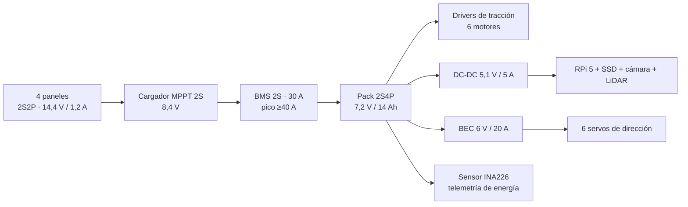

# Cálculo energético y dimensionado de la batería

> Estado: Borrador · Versión: 0.1 · Revisión: 2026-11-21 · Responsable: Diseño electrónico
>
> **Nota ADR-0010 (2026-11-21):** este estudio asume una Raspberry Pi 5 8 GB.
> La base vigente es una Raspberry Pi 4 8 GB + Argon ONE; si se adopta la
> variante 6×6, recalcular consumo, BOM y compatibilidad. La decisión Pi 4 no
> cambia OQ-09.

Este documento estima el consumo del rover, dimensiona la batería y revisa si
los servos MG90S son suficientes para la dirección de las seis ruedas. Es un
**cálculo preliminar de prediseño**: el motor de tracción todavía no está
elegido y la masa no se ha pesado. Ningún resultado se presenta como medición.

> **Relación con otros documentos:** `docs/04-diseno/diseno-electrico.md` y
> `docs/04-diseno/bom.md` describen la base de 2 motores y LiFePO4 de 12,8 V.
> Este cálculo es el **estudio paralelo 6×6**, con pack Li-ion 2S4P de 8 celdas
> y paneles de 7,2 V. El diseño eléctrico de la variante está en
> [`diseno-electrico-6x6.md`](diseno-electrico-6x6.md) y su BOM en
> [`bom-6x6.md`](bom-6x6.md). No sustituye la base hasta resolver **OQ-09**; si
> se adopta, requiere un ADR de energía.

## 1. Resumen ejecutivo

| Pregunta | Resultado preliminar |
|---|---|
| Consumo medio en demo de 20 min | 18,7 W · 6,2 Wh |
| Consumo medio en misión de 45 min | 18,4 W · 13,8 Wh |
| Consumo medio en misión de 60 min | 18,4 W · 18,4 Wh |
| Consumo en crucero / pendiente del 10 % | 20,4 W / 27,3 W |
| Batería seleccionada (variante 6×6) | **8 celdas de 3,6 V / 3500 mAh en 2S4P** (7,2 V, 14 Ah, 100,8 Wh) |
| Autonomía con esa batería | 4,39 h al 80 % de descarga; 5,9 misiones de 45 min |
| Requisito RNF-06 (≥30 min) | Se cumple con ~8,8× de margen estimado |
| Batería mínima recomendada | 4 celdas en 2S2P (50,4 Wh); 2S1P no se recomienda |
| Masa extra del pack | +192 g de celdas frente a 2S2P, más soporte y carcasa |
| Carga | ≈7,1 h con 2 A; ≈3 h con 5 A |
| Paneles solares | 17,3 Wp STC; 9,3–11,7 W reales; 28–35 Wh/día; **no sostienen el consumo** |
| Servos MG90S | **No suficientes**. Mínimo clase MG995/MG996R (10 kg·cm); recomendado 20 kg·cm |
| Drivers | 3 × TB6612 si el motor es ≤1 A continuo y ≤3 A de pico; si no, 6 × DRV8871/BTS7960 |

> **Decisión preliminar:** pack **2S4P de 8 celdas**, BMS de 2S/30 A (pico
> ≥40 A), fusible de 30 A, cargador de 8,4 V / 5 A y dos convertidores separados
> (5 V para el Pi, 6 V para los servos).
> Los paneles se conectan en 2S2P (14,4 V) a través de un cargador MPPT de 2S;
> nunca directamente a la batería.

## 2. Supuestos

| ID | Supuesto | Valor | Origen | Estado |
|---|---|---|---|---|
| S1 | Masa del rover | 6 kg | Estimación de prediseño | Pendiente de pesaje |
| S2 | Radio de rueda | 60 mm | Estimación | Pendiente de diseño mecánico |
| S3 | Velocidad de crucero | 0,30 m/s | Requisito de demo asumido | Pendiente de confirmar |
| S4 | Coeficiente de rodadura | 0,08 | Hierba/grava compacta, estimación | Pendiente de medir |
| S5 | Pendiente de cálculo | 10° | Escenario exigente asumido | Pendiente de confirmar |
| S6 | Rendimiento motor + reductor | 45 % | Estimación conservadora | Pendiente de medir |
| S7 | Motor de tracción | Pololu 25D LP 6 V 99:1 con encoder | Referencia de cálculo, **no seleccionado** | Pendiente de decisión |
| S8 | Consumo del Pi 5 | 4,0 W (800 mA a 5 V) | F-001 | Alto |
| S9 | Cámara Module 3 | 1,25 W (250 mA a 5 V) | F-001 | Alto |
| S10 | NVMe y ventilador | 1,5 W + 0,3 W | Estimación | Medio |
| S11 | LiDAR 2D | 0,5 W | F-007 | Alto, si se usa |
| S12 | Servos | 6 × MG995, media 78 mA, bloqueo 2,5 A | F-004 + estimación de corriente de bloqueo | Medio |
| S13 | Paneles | 4 × 7,2 V × 600 mA | F-008; no se sabe si 600 mA es `Imp` o `Isc` | Pendiente de medir |
| S14 | Horas de sol pico | 3,0 h/día | Estimación para Cracovia en septiembre | Pendiente de PVGIS |
| S15 | Profundidad de descarga | 80 % | Criterio de vida útil | Decisión de diseño |
| S16 | Rendimiento convertidores | 90 % (5 V), 85 % (6 V) | Estimación | Medio |

> **Supuesto clave:** se interpreta “2 acelerómetros y 2 giroscopios” como
> **2 módulos IMU**, cada uno con acelerómetro y giroscopio de 3 ejes. Su consumo
> es despreciable (<0,2 W) y no altera el dimensionado. Si se trata de cuatro
> sensores separados, el consumo sigue siendo despreciable, pero cambia el
> conteo de componentes.

## 3. Arquitectura eléctrica propuesta



| Riel | Tensión | Carga | Dimensionado |
|---|---|---|---|
| Tracción | 7,2 V nominal, PWM limitado al 83 % a 7,2 V (6 V equivalentes) | 6 motores, 2 A de bloqueo cada uno | 6 canales de 2 A; drivers con límite de corriente |
| Pi 5 | 5,1 V | 1,7 A típicos; 5 A máximos oficiales | Convertidor de 5 A (25 W) |
| Servos | 6 V | 6 servos, 2,5 A de bloqueo cada uno | BEC de 20 A (120 W) |
| Carga solar | 8,4 V | 2 A | MPPT de 2S Li-ion, ≥2 A |

El Pi 5 recomienda oficialmente 5 V / 5 A para no limitar los puertos USB
(F-001). Aunque la carga real prevista sea de 1,7 A, el convertidor se
dimensiona a 5 A para cubrir picos, SSD y futuros periféricos. Los servos **no** se alimentan del
riel de 5 V del Pi: su corriente de bloqueo agregada puede superar los 15 A.

## 4. Presupuesto de potencia

### 4.1 Cargas medias

| Carga | Cantidad | Riel | Potencia unitaria | Potencia total |
|---|---:|---|---:|---:|
| Raspberry Pi 5 8 GB | 1 | 5 V | 4,00 W | 4,00 W |
| SSD NVMe (opcional) | 1 | 5 V | 1,50 W | 1,50 W |
| Camera Module 3 | 1 | 5 V | 1,25 W | 1,25 W |
| LiDAR 2D (opcional) | 1 | 5 V | 0,50 W | 0,50 W |
| MCU de control | 1 | 5 V | 0,50 W | 0,50 W |
| Enlace RC / telemetría | 1 | 5 V | 0,30 W | 0,30 W |
| Ventilador del Pi 5 | 1 | 5 V | 0,30 W | 0,30 W |
| **Subtotal 5 V** | | | | **8,35 W** |
| Servos de dirección (media) | 6 | 6 V | 0,47 W | 2,81 W |
| **Electrónica en los rieles** | | | | **11,16 W** |
| **Electrónica vista por la batería** | | | | **12,58 W** |

La potencia vista por la batería incluye las pérdidas de los convertidores:
8,35 W / 0,90 = 9,28 W en el riel de 5 V y 2,81 W / 0,85 = 3,30 W en el de 6 V.

### 4.2 Modos de operación

| Modo | Tracción | Servos + electrónica | Total |
|---|---:|---:|---:|
| Reposo (Pi encendido, motores parados) | 0 W | 12,58 W | **12,58 W** |
| Crucero en llano a 0,30 m/s | 7,86 W | 12,58 W | **20,44 W** |
| Pendiente del 10 % a 0,30 m/s | 14,67 W | 12,58 W | **27,25 W** |
| Falla: 6 motores y 6 servos bloqueados | 72,0 W | 105,9 W | **187,2 W** |

La tracción en llano es pequeña (1,41 W mecánicos) comparada con las pérdidas
en vacío de los seis motores (4,32 W). Por eso el consumo no baja de forma
proporcional al reducir la velocidad: a baja velocidad dominan la electrónica y
las pérdidas del reductor. En la fila de falla, la columna de servos incluye las
pérdidas del BEC (90 W en el servo + 15,9 W disipados).

El caso de falla no es un modo de operación normal. Sirve para dimensionar
fusible, BMS, cableado y límites de corriente. Con 2S4P la corriente de falla
es de 26,0 A en el pack y 6,5 A por celda; con 2S2P serían 13,0 A por celda y
con 2S1P, 26,0 A por celda, muy por encima de lo que una 18650 de 3500 mAh
suele admitir. Es una estimación a tensión nominal: a 8,4 V la corriente de
bloqueo de los motores puede ser
mayor, así que el BMS y el fusible deben tener margen.

## 5. Energía de misión

| Perfil | Reparto | Potencia media | Energía |
|---|---|---:|---:|
| Demo de 20 min | 50 % crucero, 15 % pendiente, 35 % reposo | 18,71 W | **6,24 Wh** |
| Requisito RNF-06 (30 min) | 50 % crucero, 15 % pendiente, 35 % reposo | 18,71 W | **9,36 Wh** |
| Misión de 45 min | 55 % crucero, 10 % pendiente, 35 % reposo | 18,37 W | **13,78 Wh** |
| Misión de 60 min | 55 % crucero, 10 % pendiente, 35 % reposo | 18,37 W | **18,37 Wh** |

Regla práctica para este diseño: **0,31 Wh por minuto** de misión mixta. Sirve
para estimar rápido, pero no sustituye al perfil real de waypoints.

## 6. Batería

### 6.1 Opciones con celdas de 3,6 V / 3500 mAh

| Pack | Celdas | Energía | Energía útil (80 %) | Autonomía | Misiones de 45 min | Corriente por celda |
|---|---:|---:|---:|---:|---:|---:|
| 2S1P | 2 | 25,2 Wh | 20,2 Wh | 1,10 h | 1,5 | 2,55 A |
| 2S2P | 4 | 50,4 Wh | 40,3 Wh | 2,19 h | 2,9 | 1,28 A |
| 2S3P | 6 | 75,6 Wh | 60,5 Wh | 3,29 h | 4,4 | 0,85 A |
| **2S4P** | **8** | **100,8 Wh** | **80,6 Wh** | **4,39 h** | **5,9** | **0,64 A** |
| 2S8P | 16 | 201,6 Wh | 161,3 Wh | 8,78 h | 11,7 | 0,32 A |

### 6.2 Configuración elegida

**8 celdas en 2S4P (7,2 V, 14 Ah, 100,8 Wh).** Es la configuración elegida para
la variante 6×6: cubre un día completo de competición (5,9 misiones de 45 min;
4,39 h) y baja el pico por celda a 6,5 A. El requisito RNF-06 (≥30 min) queda
con ≈8,8× de margen. Razones:

1. Permite 5–6 mangas de 45 min sin recargar, con margen para viento, arena o
   recalcular rutas.
2. Reparte la corriente entre cuatro ramas paralelas: 0,64 A por celda de media
   en misión y 6,5 A en el pico de falla, frente a 13,0 A en 2S2P.
3. Menos caída de tensión y menos calentamiento; las celdas sufren menos y
   pueden ser de 8–10 A continuos.
4. Sigue siendo 2S (7,2 V), compatible con los motores de 6 V, el cargador de
   8,4 V y los paneles 2S2P.

**Coste:** +192 g de celdas (más soporte y carcasa), volumen aproximadamente
doble y ≈7,1 h de carga con 2 A. Para uso real, cambiar a un cargador de **5 A**
(≈3 h) y verificar que el BMS admita esa corriente de carga.

**Alternativas:**

- **2S2P (4 celdas, 50,4 Wh):** mínimo para una demo de 30–60 min; ya cumple
  RNF-06 con 4,4× de margen y pesa 192 g menos.
- **2S3P (6 celdas, 75,6 Wh):** punto medio si se quieren 4–5 mangas.
- **2S8P (16 celdas, 201,6 Wh):** sobredimensionado para este rover; solo con
  cargador rápido y chasis reforzado.

La opción de 2 celdas (2S1P) solo se acepta si la misión se limita a 20–30 min,
se pesa el rover y se limita la corriente agregada a ≤8 A (por ejemplo, con
drivers y BEC con límite de corriente). Aunque su energía daría para ~1,1 h, el
límite real es la corriente de los 12 actuadores, no la capacidad. No se
recomienda para las seis ruedas.

> **Verificar las celdas:** con 2S4P el pico de falla es 6,5 A por celda; una
> celda de 10 A continuos tiene margen. Si se baja a 2S2P, el pico sube a
> 13,0 A y hace falta pulso ≥15 A. Una celda genérica de 3500 mAh con límite de
> 5–8 A no es adecuada para 2S2P, aunque la media sea baja.

> **No usar 3S (11,1 V) con motores de 6 V.** Obligaría a un convertidor de
> tracción de al menos 15 A o a limitar el PWM, con más pérdidas y más masa. El
> sistema de 2S es coherente con los motores de 6 V y con los paneles de 7,2 V.

### 6.3 ¿Más celdas? 6, 8 o 16

Cuidado con la notación: **6 celdas = 2S3P**, **8 celdas = 2S4P** y
**2S8P = 16 celdas**, no 8. La energía y la autonomía escalan, pero también la
masa, el volumen, el tiempo de carga y la dificultad de equilibrar el pack.

| Pack | Celdas | Energía | Autonomía | Misiones de 45 min | Pico por celda | Masa extra vs 4 celdas (solo celdas) | Carga a 2 A | Días de sol (28–35 Wh/día) |
|---|---:|---:|---:|---:|---:|---:|---:|---:|
| 2S2P | 4 | 50,4 Wh | 2,19 h | 2,9 | 13,0 A | 0 g | ≈3,5 h | 1,4–1,8 |
| 2S3P | 6 | 75,6 Wh | 3,29 h | 4,4 | 8,7 A | +96 g | ≈5,3 h | 2,2–2,7 |
| 2S4P | 8 | 100,8 Wh | 4,39 h | 5,9 | 6,5 A | +192 g | ≈7,1 h | 2,9–3,6 |
| 2S8P | 16 | 201,6 Wh | 8,78 h | 11,7 | 3,3 A | +576 g | ≈14,1 h | 5,8–7,2 |

**Ventajas de añadir celdas en paralelo:**

- Más energía y más mangas por carga.
- Menos corriente por celda en el pico: 13 A en 2S2P frente a 6,5 A en 2S4P y
  3,3 A en 2S8P.
- Menos caída de tensión y menos calentamiento; las celdas sufren menos.
- Más tolerancia a una celda débil, siempre que el BMS detecte el desequilibrio.

**Costes:**

- Masa: 96 g por cada dos celdas, más soporte y carcasa. Con 16 celdas el
  rover ya no pesaría 6 kg y habría que recalcular el par de dirección y el
  consumo.
- Volumen: el pack 2S8P ocupa aproximadamente cuatro veces el 2S2P.
- Carga: el cargador de 2 A tarda 14 h en un 2S8P; haría falta uno de 5–10 A
  y un BMS que admita esa corriente de carga.
- Solar: 28–35 Wh/día tardan casi una semana en recargar un 2S8P. Los paneles
  no justifican un pack tan grande.
- Equilibrado: un BMS 2S solo ve dos grupos serie; una celda mala dentro de un
  paralelo de 8 es difícil de detectar. Más paralelo exige celdas matched y
  revisiones periódicas.

**Recomendación:**

- **2S2P (4 celdas):** mínimo para la demo de 30–60 min; ya cumple RNF-06 con
  margen y pesa 192 g menos.
- **2S3P (6 celdas):** buen equilibrio si se quieren 4–5 mangas por carga.
- **2S4P (8 celdas):** **elegido** para la variante 6×6; cubre un día completo
  de competición sin recargar, +192 g y carga de ~7 h a 2 A.
- **2S8P (16 celdas):** solo si la autonomía es el requisito dominante, hay
  cargador rápido y el chasis soporta el peso. Para este rover es
  sobredimensionado.

### 6.4 BMS, protecciones y carga

- BMS de 2S de **puerto común**, con equilibrado, **30 A continuos, ≥40 A de
  pico y carga ≥5 A**, y protección de sobredescarga, sobrecarga y
  cortocircuito.
- Fusible principal de **30 A** (curva lenta) lo más cerca posible del positivo
  del pack; cable de **14 AWG** en el circuito principal y 16 AWG en las ramas
  de motor.
- Interruptor general de 30 A y parada de emergencia **normalmente cerrada y
  enclavada** que corte los actuadores (tracción y servos), no solo la lógica.
  El Pi puede seguir alimentado para registrar el evento.
- Conector XT60, dimensionado para ≥30 A; evitar conectores de clavija
  expuestos y usar XT30 solo en ramas de menos de 15 A.
- Cargador externo de **8,4 V / 5 A CC-CV** para 2S4P; 2 A basta para
  2S2P/2S3P. Verificar que el BMS admita la corriente de carga. La carga solar
  debe pasar por el MPPT y el BMS, nunca directa.
- Sensores de temperatura en el pack y el cargador; no cargar por debajo de
  0 °C ni dejar la carga solar sin supervisión en un recinto cerrado.
- Las celdas deben ser del mismo modelo, lote y estado. No mezclar celdas
  usadas con nuevas.

> **BMS y capacidad:** el BMS se dimensiona por la corriente de carga/descarga,
> no por los Ah. Con 2S4P el BMS de 30 A sigue siendo suficiente; lo que cambia
> es la capacidad, no la corriente de la carga. Sí hay que revisar la corriente
> de carga si se pasa a un cargador de 5 A y mantener las celdas equilibradas.

## 7. Paneles solares

### 7.1 Cálculo

| Concepto | Valor |
|---|---:|
| Potencia STC (4 × 7,2 V × 0,6 A) | 17,28 W |
| Potencia efectiva al mediodía si 600 mA es `Imp` | 11,66 W |
| Potencia efectiva al mediodía si 600 mA es `Isc` | 9,33 W |
| Energía diaria con 3 h de sol pico (`Imp`) | 35,0 Wh |
| Energía diaria con 3 h de sol pico (`Isc`) | 28,0 Wh |
| Déficit instantáneo frente a crucero (`Isc`) | −11,11 W |
| Misiones de 45 min por día (`Isc`) | 2,0 |

El cálculo aplica un factor de 0,75 por temperatura, inclinación y suciedad, y
un rendimiento de carga del 90 %. Si los 600 mA son `Isc`, la corriente de
trabajo es un 20 % menor; por eso se muestran los dos casos.

### 7.2 Veredicto

Los paneles **no pueden alimentar el rover por sí solos**: entregan 9,3–11,7 W
al mediodía frente a 20,4 W de consumo en crucero. La batería cubre el déficit
y los paneles solo lo compensan parcialmente durante el día. Con 3 h de sol pico,
la energía diaria (28–35 Wh) alcanza para unas 2 misiones de 45 min o 4–5 demos
de 20 min, sin contar días nublados.

Esto es suficiente para una demo de competición con recargas entre mangas, pero
no para operación continua. Si se necesita autonomía solar real, haría falta más
que duplicar la superficie de paneles o reducir el consumo del Pi 5 y de los
servos.

### 7.3 Conexión

- **2S2P**: dos ramas de dos paneles en serie. Resultado: 14,4 V nominales,
  1,2 A. Es la configuración recomendada porque permite un cargador reductor
  MPPT hacia 8,4 V y tolera mejor las sombras parciales que los cuatro paneles
  en serie.
- **4P** (7,2 V, 2,4 A) no sirve para cargar un pack 2S: la tensión de carga es
  8,4 V y el panel no llega. Habría que usar un convertidor elevador, con más
  pérdidas.
- **4S** (28,8 V, 0,6 A) también funciona con un reductor, pero una sombra en
  un panel hunde toda la rama. No se recomienda para un rover.
- El cargador debe ser **MPPT para 2S Li-ion, 8,4 V, ≥2 A**, con detección de
  temperatura. Verificar en la hoja de datos que la tensión de flotación sea
  exactamente 8,4 V, no 8,2 V ni 8,6 V.

## 8. Servos de dirección

### 8.1 Modelo de par

Para girar una rueda parada sobre su eje vertical, el par dominante es la
fricción del neumático multiplicada por el radio de arrastre (*scrub radius*):

```text
T = SF · μ · (m · g / 6) · r_s
```

con `SF = 2` (factor de seguridad), `μ = 0,8` (arena/grava), `r_s = 30 mm` y
reparto uniforme entre seis ruedas. Es una aproximación estática; no incluye el
par de autoalineación con el rover en movimiento ni los impactos, que se cubren
con el factor de seguridad.

### 8.2 Resultados

| Masa | Fuerza por rueda | Par requerido | MG90S 2,2 kg·cm | MG995 10 kg·cm | Clase 20 kg·cm |
|---:|---:|---:|---|---|---|
| 4 kg | 6,54 N | 3,20 kg·cm | No | OK | OK |
| 6 kg | 9,81 N | 4,80 kg·cm | No | OK | OK |
| 8 kg | 13,08 N | 6,40 kg·cm | No | OK | OK |
| 10 kg | 16,35 N | 8,00 kg·cm | No | Marginal | OK |
| 12 kg | 19,62 N | 9,60 kg·cm | No | Marginal | OK |

> **Sensibilidad al diseño mecánico:** la tabla usa una rueda de 60 mm y un
> `scrub radius` de 30 mm. Si se adopta la rueda de 90 mm del diseño mecánico
> actual y el `scrub radius` sube a 45 mm, el par a 6 kg sería de 7,2 kg·cm; el
> MG995 quedaría con solo 1,4× de margen y el servo de 20 kg·cm se justifica
> aún más.

### 8.3 Veredicto sobre los MG90S

**No son suficientes.** Con 6 kg de masa y un factor de seguridad de 2, el par
necesario es 4,80 kg·cm por rueda; el MG90S entrega 2,2 kg·cm a 6,6 V (F-003),
menos de la mitad. Además, 2,2 kg·cm es el mejor caso a 6,6 V; con un BEC de 6 V
el par disponible es algo menor. Incluso con 4 kg de masa el requisito
(3,20 kg·cm) supera su par de bloqueo. Añadir impactos de arena o giros con el
rover en movimiento solo empeora el margen.

| Opción | Par a 6 V | Evaluación |
|---|---:|---|
| MG90S | 2,2 kg·cm | **Descartado** para dirección |
| MG90D | 2,4 kg·cm | Descartado; misma clase |
| MG995 / MG996R | 10 kg·cm | **Mínimo viable** hasta 8 kg; marginal a 10–12 kg |
| Clase 20 kg·cm (p. ej. DS3218MG) | ≈20 kg·cm | **Recomendado** para 6–10 kg y uso off-road |

> El MG995 está respaldado por F-004. El MG996R es de la misma clase, pero su
> par y corriente de bloqueo deben verificarse en la hoja del fabricante. El
> DS3218MG es un candidato de 20 kg·cm; comprobar el par a 6 V, no a 6,8 V.

Recomendaciones adicionales:

- Usar servos con engranajes metálicos y doble rodamiento; el MG90S es un
  microservo de 13,4 g, no un servo de dirección de rover.
- Montar un **servo saver** o embrague mecánico para proteger los engranajes
  ante impactos.
- Alimentar los seis servos desde un BEC de 6 V / 20 A, con cableado de sección
  suficiente y condensadores cerca de cada servo.
- Verificar el par real con un dinamómetro o una balanza de resorte antes de
  fijar el modelo: `T = F × brazo`.
- Si el diseño mecánico permite, reducir el `scrub radius` o añadir rodamientos
  en el pivote: baja el par requerido más que cambiar de servo.

## 9. Drivers y conteo de componentes

### 9.1 Regla de selección del driver

El driver debe cumplir:

```text
I_continua ≥ 1,5 × I_nominal del motor
I_pico     ≥ I_bloqueo del motor
```

Con el motor de referencia (2,0 A de bloqueo, régimen continuo muy por debajo
de 1 A), el TB6612FNG de 1 A continuo / 3 A de pico por canal es suficiente:
tres placas duales para seis motores. Si el motor elegido supera 1 A continuo o
3 A de pico, hay que pasar a seis drivers individuales con capacidad de pico
igual o mayor que la corriente de bloqueo (DRV8871, BTS7960 u otro equivalente,
según su hoja de datos), y recalcular el presupuesto.

> **Riesgo:** si se compran tres TB6612 antes de elegir el motor y luego se
> monta un 37D de 12 V con 5 A de bloqueo, los drivers se destruyen. La compra
> del driver debe esperar a la decisión del motor.

### 9.2 Conteo

| Elemento | Cantidad | Nota |
|---|---:|---|
| Motores de tracción con encoder | 6 | 6 ruedas motrices independientes |
| Ruedas | 6 | Radio de cálculo: 60 mm |
| Drivers duales TB6612 | 3 | Solo si el motor cumple la regla anterior |
| Alternativa: drivers DRV8871 | 6 | Si el motor supera 1 A continuo |
| Servos de dirección | 6 | Clase ≥10 kg·cm; 20 kg·cm recomendado |
| Driver de servos PCA9685 | 1 | 16 canales PWM por I²C |
| MCU de control (RP2040/Teensy) | 1 | 6 PWM de motor + 6 encoders; el Pi no tiene 12 PWM |
| Convertidor 5,1 V / 5 A | 1 | Pi 5, SSD, cámara, LiDAR |
| BEC 6 V / 20 A | 1 | Servos, separado del riel de 5 V |
| Celdas 18650 3,6 V / 3500 mAh | 8 | Pack 2S4P |
| BMS 2S / 30 A (pico ≥40 A, carga ≥5 A) de puerto común | 1 | Protección, balanceo y carga simultánea |
| Cargador 8,4 V / 5 A | 1 | CC-CV para el pack |
| Paneles solares | 4 | 7,2 V / 600 mA |
| Cargador MPPT 2S | 1 | 14,4 V de entrada, 8,4 V de salida |
| Sensor de corriente/tensión INA226 | 1 | Telemetría de energía para evidencia |
| Fusible de 30 A + portafusible | 1 | Lo más cerca posible del pack |
| Interruptor general 30 A | 1 | Corte de todo el sistema |
| Parada de emergencia | 1 | NC y enclavada; corta tracción y servos |
| IMUs (acelerómetro + giroscopio) | 2 | Interpretación de “2 acelerómetros y 2 giroscopios” |
| Cable 14 AWG (principal) y 16 AWG (motores), XT60, terminales | — | Dimensionado para ≥30 A |

> **Hallazgo de integración:** seis motores y seis servos son 12 actuadores.
> El Raspberry Pi 5 no tiene suficientes canales PWM de hardware ni entradas de
> encoder para gobernarlos directamente. Hace falta un microcontrolador
> dedicado (RP2040, Teensy o similar) y un PCA9685 para los servos. Esto no
> estaba en la lista inicial y afecta al BOM y al consumo (0,5 W estimados).

## 10. Riesgos y verificaciones pendientes

| ID | Riesgo | Impacto | Mitigación |
|---|---|---|---|
| R-01 | Motor de tracción sin elegir | El consumo puede variar 2–3× | Elegir motor y medir curva I-V antes de comprar drivers |
| R-02 | Masa no pesada | El par de dirección y la energía cambian | Pesar el prototipo y repetir el cálculo |
| R-03 | Paneles: 600 mA ¿`Imp` o `Isc`? | 20 % de incertidumbre en la energía solar | Medir `Voc` e `Isc` al sol y con carga |
| R-04 | Radiación solar de la sede | 28–35 Wh/día es una estimación | Consultar PVGIS para fecha y ubicación reales |
| R-05 | Corriente de bloqueo de servos | BEC y cableado podrían quedar cortos | Medir con fuente de laboratorio; dimensionar 20 A |
| R-06 | Celdas 18650 genéricas | Descarga máxima menor de la esperada | Usar celdas con hoja de datos y BMS de calidad |
| R-07 | Carga de Li-ion desatendida | Riesgo de incendio | BMS, fusible, sensor de temperatura, carcasa ignífuga |
| R-08 | Reglamento ERC 2027 no verificado | Límites de batería o química desconocidos | Consultar el reglamento oficial antes de comprar el pack definitivo |
| R-09 | Sin evidencia de autonomía | El cálculo no está validado | Prueba con telemetría de corriente y registro en `docs/08-evidencia/` |
| R-10 | Cambio de arquitectura 12,8 V → 7,2 V sin ADR | Compras y diseño inconsistentes | Aprobar un ADR de energía antes de comprar |

## 11. Reproducción

El cálculo se genera con un script sin dependencias externas:

```bash
make energy
# o directamente:
python3 scripts/energy/calculo_energia.py
python3 scripts/energy/calculo_energia.py --json
```

Los parámetros (masa, motor, eficiencias, paneles, etc.) están en las clases
`Rover`, `Motor`, `Electronics`, `Pack` y `Solar` del script. Al cambiar un
supuesto, se vuelve a ejecutar y se actualiza este documento.

Ejecución de referencia: 2026-11-21, Fedora 43, Python 3.14.10. Es un cálculo
de prediseño, **no una medición del rover**. La evidencia de autonomía real
sigue en estado `Pendiente` hasta que exista una prueba con telemetría de
corriente en `docs/08-evidencia/`.

## 12. Fuentes

Las fuentes primarias y sus fechas de acceso están en
[`docs/01-investigacion/fuentes.md`](../../01-investigacion/fuentes.md). Las
principales para este documento son F-001 a F-008. Los datos de paneles y
baterías provienen del responsable del proyecto (F-008) y están pendientes de
verificación experimental.
