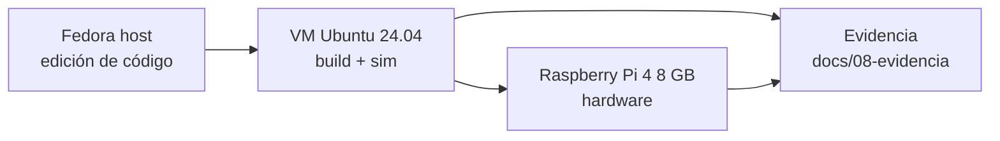

# Entorno de desarrollo

> Estado: Borrador · Versión: 0.1 · Revisión: 2026-11-21 · Responsable: rol de Software

## 1. Situación actual

| Elemento | Valor |
|---|---|
| Host principal | Fedora Linux 43 (x86_64) |
| Python del host | 3.14.10 |
| ROS 2 | **No instalado** |
| Gazebo | **No instalado** |
| Docker | **No instalado** |
| Podman | Instalado |
| Memoria | 31 GB |
| CPU | 4 núcleos |
| Disco libre | 1.8 TB |

ROS 2 Jazzy se distribuye para **Ubuntu 24.04 Noble** (amd64 y arm64). En Fedora no hay binarios oficiales. Por eso el desarrollo y la simulación se hacen en uno de estos entornos:

| Opción | Recomendación | Ventajas | Inconvenientes |
|---|---|---|---|
| **VM Ubuntu 24.04** | **Recomendada** | Aislamiento, snapshot, GUI fácil | Consume RAM/CPU; GPU virtual limitada |
| Podman/Docker Ubuntu 24.04 | Alternativa | Reproducible, ligero | GPU/X11 complicados para Gazebo |
| Ubuntu 24.04 nativo | Si se puede | Máximo rendimiento | Cambiar el host |
| Raspberry Pi 4 8 GB directo | Para hardware | Entorno real | Lento para desarrollo, headless |

## 2. Versiones objetivo

| Software | Versión | Verificación |
|---|---|---|
| Ubuntu | 24.04 LTS (Noble) | `lsb_release -a` |
| ROS 2 | Jazzy Jalisco | `ros2 --version` / `echo $ROS_DISTRO` |
| Gazebo | Harmonic | `gz sim --versions` |
| Nav2 | Jazzy | `ros2 pkg list \| grep nav2` |
| Python | 3.12 (Ubuntu 24.04) | `python3 --version` |
| colcon | Última de `ros-dev-tools` | `colcon version-check` |
| Git | ≥ 2.40 | `git --version` |

> No fijamos números de parche porque cambian. Sí fijamos la **distro** y registramos las versiones exactas en cada evidencia.

## 3. Opción A — VM Ubuntu 24.04 (recomendada)

### Requisitos de la VM

- 4 vCPU (8 recomendadas).
- 8 GB RAM (16 recomendadas para Gazebo + RViz).
- 40 GB de disco.
- Aceleración 3D activada.
- Red en modo NAT o puente.

### Pasos

1. Descargar la ISO de Ubuntu 24.04 LTS.
2. Crear la VM con VirtualBox, VMware o KVM/QEMU.
3. Instalar Ubuntu con usuario `rover`.
4. Actualizar: `sudo apt update && sudo apt upgrade -y`.
5. Instalar herramientas: `sudo apt install -y git curl build-essential`.
6. Dentro de la VM, clonar el repo o montar la carpeta del host.
7. Ejecutar `scripts/check_env.sh` y `scripts/setup/install_ros_jazzy.sh --dry-run`.

### Carpetas compartidas

- VirtualBox: `sharedfolder` con montaje en `/media/sf_rover`.
- VMware: `vmhgfs-fuse`.
- KVM: `virtiofs` o `9p`.

Si `colcon build --symlink-install` falla por el sistema de archivos compartido, compilar dentro de la VM y copiar solo la evidencia al host.

## 4. Opción B — Contenedor Podman/Docker

```bash
# Imagen oficial de ROS 2 Jazzy
podman pull docker.io/osrf/ros:jazzy-desktop

# Ejecutar con X11 y GPU (requiere configuración)
podman run -it --rm \
  --net=host \
  -e DISPLAY=$DISPLAY \
  -v /tmp/.X11-unix:/tmp/.X11-unix:ro \
  -v "$PWD":/workspace:Z \
  -w /workspace \
  docker.io/osrf/ros:jazzy-desktop
```

> Gazebo dentro de un contenedor requiere acceso a GPU (`--device /dev/dri`) y a X11. Si falla el renderizado, usar `LIBGL_ALWAYS_SOFTWARE=1` o pasar a una VM.

### Limitaciones

- El reloj y la red pueden comportarse distinto.
- Los dispositivos USB (LiDAR) requieren `--device` y reglas udev.
- No sustituye a la validación en hardware.

## 5. Opción C — Raspberry Pi 4 8 GB

- Ubuntu 24.04 Server 64-bit.
- SSD USB 3.0 recomendado (la Pi 4 no expone NVMe); microSD A2 como mínimo.
- Carcasa Argon ONE con ventilador; verificar el acceso al CSI.
- SSH habilitado.
- Sin entorno gráfico; RViz2 se ejecuta en la estación de operación.
- El Pi ejecuta ROS 2, Nav2 y los drivers.

### Configuración inicial

```bash
sudo apt update && sudo apt upgrade -y
sudo apt install -y git curl build-essential
bash scripts/setup/install_ros_jazzy.sh
```

## 6. Red y DDS

- Definir `ROS_DOMAIN_ID` único por equipo (por ejemplo, 42).
- Evitar WiFi congestionado; usar 5 GHz o Ethernet.
- Para depuración, `ROS_LOCALHOST_ONLY=1` aísla el tráfico.
- Verificar con `ros2 multicast receive` / `ros2 multicast send`.
- El firewall del host puede bloquear DDS; permitir tráfico local.

```bash
export ROS_DOMAIN_ID=42
export ROS_LOCALHOST_ONLY=0
```

## 7. Flujo de trabajo



1. Editar en el host o en la VM.
2. Compilar y probar en la VM.
3. Registrar evidencia.
4. Desplegar en el Pi.
5. Repetir la misión y comparar métricas.

## 8. Comprobación del entorno

```bash
bash scripts/check_env.sh
```

El script informa de:

- SO, kernel y arquitectura.
- Versión de Python.
- Presencia de ROS 2, Gazebo, colcon, Git, Make.
- Variables `ROS_DISTRO`, `ROS_DOMAIN_ID`.
- Memoria y disco.
- Recomendación de siguiente paso.

## 9. Problemas frecuentes

| Síntoma | Causa probable | Solución |
|---|---|---|
| `ros2: command not found` | No se hizo `source` | `source /opt/ros/jazzy/setup.bash` |
| Gazebo no abre ventana | Wayland/X11 o GPU | Usar X11, `LIBGL_ALWAYS_SOFTWARE=1`, o VM con aceleración |
| RViz no muestra el robot | TF incompleta o `use_sim_time` | Revisar `/tf`, `/clock`, `robot_state_publisher` |
| Nav2 no planifica | Mapa mal cargado o pose inicial | Revisar `map_server`, AMCL, pose inicial |
| `colcon build` falla por symlink | Carpeta compartida | Compilar dentro de la VM |
| Topics no se ven entre máquinas | DDS/firewall | Mismo `ROS_DOMAIN_ID`, red, `ROS_LOCALHOST_ONLY=0` |
| CPU al 100% | RViz/MPPI en el Pi | RViz en el PC, RPP en el Pi |

## 10. Referencias

- [F-06] ROS 2 Jazzy Installation.
- [F-11] Ubuntu for Raspberry Pi.
- [F-18] Matriz de soporte de Ubuntu en Pi.
- [`guia-instalacion.md`](guia-instalacion.md).
