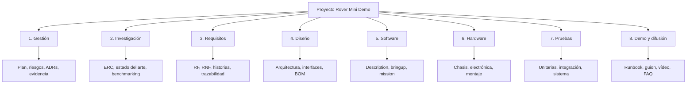
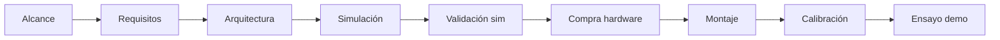

# Plan de proyecto

> Estado: Borrador · Versión: 0.1 · Revisión: 2026-11-21 · Responsable: rol de Gestión de Proyecto

## 1. Resumen

| Campo | Valor |
|---|---|
| Producto | Rover Mini Demo de navegación autónoma |
| Objetivo deportivo | European Rover Challenge 2027 (fecha por confirmar) |
| Inicio | 2026-11-21 (T0) |
| Duración estimada | 16–20 semanas hasta demo física; 24 semanas hasta ERC |
| Equipo mínimo | 2–4 personas (ver roles) |
| Presupuesto hardware | 700–1.100 EUR (estimación, ver BOM) |
| Metodología | SDLC iterativo + DSR, sprints de 2 semanas |
| Estado | Fase 0 — Concepción |

> **Supuesto:** el ERC 2027 repetirá el patrón de 2026: registro entre febrero y marzo, informe preliminar en abril, vídeo en mayo, finalistas en junio, informes finales en julio y finales en septiembre. **No es una fecha oficial.** Confirmar en [roverchallenge.eu](https://roverchallenge.eu/) y registrar la fuente.

> **Calendario vs esfuerzo:** a 2026-11-21 quedan ~10 meses de calendario
> hasta el ERC 2027. Las 16–24 semanas de la tabla son **esfuerzo estimado**,
> no calendario; el margen permite paralelizar y absorber imprevistos.

## 2. Objetivos

### Objetivo general

Construir y validar un rover mínimo capaz de navegar de forma autónoma entre waypoints en una arena tipo Marsyard, con seguridad, telemetría y evidencia reproducible, como base para el rover completo del ERC 2027.

### Objetivos específicos

| ID | Objetivo | Indicador |
|---|---|---|
| OE-01 | Validar la pila ROS 2 + Nav2 en simulación | Misión de 5 waypoints completada |
| OE-02 | Portar la pila al Raspberry Pi 5 | Misma misión ejecutada en hardware |
| OE-03 | Demostrar evitación de obstáculos | 0 colisiones en 10 ensayos |
| OE-04 | Medir y mejorar la fiabilidad | ≥ 80% de misiones exitosas |
| OE-05 | Documentar el ciclo completo | Trazabilidad 100% y evidencia sellada |
| OE-06 | Preparar la presentación al jurado | Guion de 10 min + vídeo |

## 3. Alcance por fases

| Fase | Semanas | Entregable principal | Puerta |
|---|---|---|---|
| 0. Concepción | T0–T2 | Visión, contexto, benchmarking, riesgos | G0 |
| 1. Requisitos | T2–T4 | RF, RNF, historias, trazabilidad | G1 |
| 2. Arquitectura y diseño | T4–T7 | Arquitectura, ADRs, BOM, diseño | G2 |
| 3. Implementación sim | T7–T11 | Paquete ROS 2 + mundo + mapa + misión | G3 |
| 4. Verificación sim | T11–T13 | 10 ensayos, métricas, evidencia | G4 |
| 5. Hardware | T13–T18 | Rover montado y calibrado | G3/G4 |
| 6. Operación y demo | T18–T20 | Runbook, ensayo general, vídeo | G5 |
| 7. Preparación ERC | T20–T24 | Documentos, presentación, logística | — |

> Las semanas son relativas porque no hay fecha oficial. Si el ERC 2027 se confirma para septiembre, el plan se comprime o se paraleliza.
>
> **Spike de percepción 3D (ADR-0009):** se ejecuta en paralelo, con 10
> semanas efectivas e hitos de 2 semanas. No bloquea G3/G4; si falla, se
> vuelve a A (1 CM3 + ToF) y se documenta.

## 4. EDT / WBS

### Paquetes de trabajo

| WP | Nombre | Tareas | Responsable |
|---|---|---|---|
| WP-01 | Gestión | Plan, riesgos, puertas, cambios | Gestión |
| WP-02 | Investigación | ERC, ROS 2, benchmarking, fuentes | Investigación |
| WP-03 | Requisitos | RF/RNF, historias, aceptación | Producto |
| WP-04 | Arquitectura | Componentes, interfaces, ADRs | Técnico |
| WP-05 | Software | URDF, launch, Nav2, misión | Software |
| WP-06 | Simulación | Mundo, mapa, assets, Gazebo | Software |
| WP-07 | Hardware | Chasis, electrónica, energía | Hardware |
| WP-08 | Pruebas | Casos, ejecución, métricas | QA |
| WP-09 | Seguridad | E-stop, watchdog, FMEA | Seguridad |
| WP-10 | Demo | Runbook, guion, vídeo, FAQ | Comunicación |

## 5. Hitos

| Hito | Semana | Criterio de aceptación | Estado |
|---|---|---|---|
| M0 — Alcance aprobado | T2 | Visión y contexto revisados | Pendiente |
| M1 — Requisitos congelados v1 | T4 | G1 cumplida | Pendiente |
| M2 — Arquitectura revisada | T7 | G2 cumplida | Pendiente |
| M3 — Simulación funcional | T11 | Misión de 5 waypoints en Gazebo | Pendiente |
| M4 — Validación en sim | T13 | ≥ 80% éxito y métricas | Pendiente |
| M5 — Rover físico operativo | T18 | Misión en pista | Pendiente |
| M6 — Demo ensayada | T20 | Runbook probado y vídeo | Pendiente |

## 6. Camino crítico

Dependencias críticas:

1. **Validación de simulación antes de comprar hardware.** No comprar motores/driver hasta confirmar interfaces y potencia.
2. **LiDAR y driver de motores** son los componentes con mayor plazo de entrega.
3. **La calibración de odometría** condiciona la calidad de AMCL y Nav2.
4. **La fecha del ERC 2027** puede adelantar hitos; revisar mensualmente.

## 7. Estimación de esfuerzo

| Fase | Horas estimadas | Nota |
|---|---|---|
| Gestión y documentación | 40–60 | Transversal |
| Investigación | 30–40 | Fuentes y benchmarking |
| Requisitos y arquitectura | 40–60 | Incluye revisiones |
| Software y simulación | 120–180 | Núcleo técnico |
| Hardware y montaje | 80–120 | Depende de piezas |
| Pruebas y evidencia | 60–80 | 10 ensayos + análisis |
| Demo y presentación | 30–40 | Guion, vídeo, FAQ |
| **Total** | **400–580 h** | 2–4 personas, 16–24 semanas |

> Estimación de orden de magnitud, no un compromiso contractual. Se refina al cerrar cada puerta.

## 8. Supuestos y restricciones

### Supuestos

- El equipo tiene acceso a un taller con herramientas básicas y a una pista o espacio de al menos 8 × 6 m.
- Hay presupuesto para LiDAR, Raspberry Pi 5, motores, driver y batería.
- Al menos una persona domina Linux y Python; otra puede apoyar en hardware.
- El ERC 2027 no exigirá el rover completo para participar en la categoría objetivo; el equipo decide la categoría más adelante.
- La universidad permite publicar documentación y vídeo con fines educativos.

### Restricciones

- ROS 2 Jazzy requiere Ubuntu 24.04; el host actual es Fedora 43, así que se usará VM/contenedor o el propio Pi.
- El presupuesto es limitado; se priorizan componentes COTS y repuestos accesibles.
- El rover debe poder transportarse en maleta o caja rígida.
- La operación con público exige parada de emergencia y zona de exclusión.

## 9. Comunicación y gestión

| Artefacto | Frecuencia | Dónde |
|---|---|---|
| Bitácora | Cada sesión | `docs/05-implementacion/bitacora.md` |
| Revisión de riesgos | Mensual | `docs/00-gobierno/gestion-riesgos.md` |
| Registro de decisiones | Cuando ocurra | `docs/00-gobierno/registro-decisiones.md` |
| Evidencia | Cada ejecución | `docs/08-evidencia/registro-evidencias.md` |
| Cambios | Cada release | `CHANGELOG.md` |

## 10. Próximas acciones (T0)

1. Revisar y aprobar la visión y el alcance (M0).
2. Descargar el rulebook 2026 y archivarlo con hash en `docs/01-investigacion/fuentes.md`.
3. Confirmar el hardware mínimo y pedir cotizaciones.
4. Preparar una VM Ubuntu 24.04 para validar ROS 2 Jazzy.
5. Ejecutar `make check` y sellar la primera evidencia.
