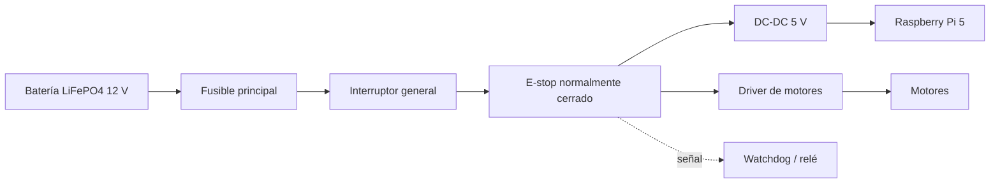

# Normativa, seguridad y buenas prácticas

> Estado: Borrador · Versión: 0.1 · Revisión: 2026-11-21 · Responsable: rol de Seguridad
> **Aviso:** este documento es una guía interna de buenas prácticas. **No certifica** el cumplimiento de ninguna norma. Antes de operar con público o participar en el ERC, revisar el reglamento oficial y las normas aplicables con un responsable de seguridad.

## 1. Principios

1. **Las personas primero.** Ninguna prueba vale más que la integridad de quien la ejecuta.
2. **Fallo seguro.** Ante pérdida de comunicación, batería baja o error de software, el rover debe detenerse.
3. **Parada accesible.** La e-stop debe estar al alcance del operador y de un segundo observador.
4. **Zona delimitada.** Nadie dentro del área de movimiento salvo el rover.
5. **Una sola persona manda.** El operador principal da las órdenes; el resto observa.
6. **Documentar antes de improvisar.** Si algo no está en el runbook, se detiene y se consulta.

## 2. Normas de referencia

| Norma | Tema | Aplicación en el proyecto |
|---|---|---|
| ISO 12100:2010 | Evaluación y reducción del riesgo de máquinas | Análisis de peligros y medidas |
| ISO 13850:2015 | Parada de emergencia | Diseño de la e-stop |
| IEC 60204-1 | Equipamiento eléctrico de máquinas | Protecciones, seccionamiento |
| IEC 62133-2 | Seguridad de baterías de litio | BMS, carga, encapsulado |
| UN 38.3 | Transporte de baterías de litio | Envío al ERC |
| ISO 31000:2018 | Gestión de riesgos | Registro de riesgos |
| CE / RED 2014/53/EU | Equipos radioeléctricos | WiFi, telemetría |
| Reglamento ERC | Requisitos de competición | Pendiente de descarga |

> La aplicación es proporcional a un prototipo universitario. No se afirma conformidad legal.

## 3. Seguridad eléctrica

### 3.1 Arquitectura de parada

- La e-stop **corta la alimentación de potencia de los motores**, no solo una señal lógica.
- El Pi puede seguir alimentado para registrar el evento, pero los motores quedan sin energía.
- Si se usa un relé o contactor, debe ser **normalmente cerrado** y abrirse al accionar la parada.
- La e-stop se prueba **antes de cada sesión**.

### 3.2 Protecciones

| Protección | Valor orientativo | Nota |
|---|---|---|
| Fusible principal | 10 A | Calcular según consumo máximo |
| Fusible de lógica | 3 A | Pi + sensores |
| Fusible de motores | 10 A | Uno por driver o uno común |
| Diodo de rueda libre | En motores | Evita picos inductivos |
| TVS | En líneas de sensores | Protección ESD |
| BMS | 4S LiFePO4 | Corte por sobre/subtensión y temperatura |

### 3.3 Cableado

- Usa cable flexible de silicona para motores; sección según corriente.
- Separa potencia y señal; cruza en ángulo recto si es necesario.
- Etiqueta ambos extremos de cada cable.
- Usa conectores con enclavamiento (XT30/XT60, JST-XH con retén).
- Aísla y fija los cables; nada suelto cerca de ruedas o piñones.

### 3.4 Tabla orientativa de sección

| Corriente | AWG recomendado | Sección aprox. |
|---|---|---|
| ≤ 3 A | 22–20 | 0.33–0.52 mm² |
| 3–5 A | 20–18 | 0.52–0.82 mm² |
| 5–10 A | 18–16 | 0.82–1.31 mm² |
| 10–20 A | 16–14 | 1.31–2.08 mm² |

> Verificar con el fabricante y la longitud del cable. A mayor longitud, mayor sección.

## 4. Baterías

### 4.1 Química

| Química | Ventajas | Riesgos | Recomendación |
|---|---|---|---|
| LiFePO4 | Estable, ciclo largo, segura | Más pesada, menor densidad | **Recomendada** |
| Li-ion 18650 | Buena densidad, económica | Requiere BMS de calidad | Alternativa con BMS |
| LiPo | Muy alta descarga | Inflamable, delicada | Evitar en demo con público |

### 4.2 Reglas

- Usa BMS con corte por temperatura y celdas balanceadas.
- Carga siempre supervisada, en superficie ignífuga y lejos de material inflamable.
- No cargues dentro del rover ni durante la noche sin supervisión.
- Almacena a ~50% de carga en lugar seco y fresco.
- Inspecciona hinchazón, olor, calor o daño; retira inmediatamente.
- Para transporte a Polonia, consulta UN 38.3 y las restricciones de la aerolínea.
- Ten un extintor adecuado (Clase D para litio o extintor de polvo) y arena.

## 5. Seguridad mecánica

- Cubre piñones, correas y ruedas con protectores.
- Redondea bordes y esquinas; usa tuercas cautivas.
- Sujeta la batería con correa o soporte; no con velcro solo.
- El centro de gravedad debe quedar bajo y centrado.
- Comprueba que el rover no vuelque en giros a la velocidad máxima.
- Usa topes mecánicos si el brazo o el mástil pueden golpear.
- Al levantar el rover, hazlo por el chasis, nunca por cables o sensores.

## 6. Seguridad de software

| Medida | Implementación | Verificación |
|---|---|---|
| Watchdog de comandos | Detener motores si no llega `/cmd_vel` en 500 ms | TC-S-05 |
| Límite de velocidad | Parámetros de Nav2 y `velocity_smoother` | Inspección + prueba |
| Límite de aceleración | Parámetros del controlador | Inspección |
| Geofence | Mapa estático + costmap | TC-S-02 |
| Parada por batería | Nodo de monitorización (futuro) | TC-S-06 |
| Modo seguro al arrancar | Motores deshabilitados hasta `start` | TC-I-01 |
| Logs y bag | Grabación automática | TC-I-04 |

> El watchdog debe vivir en el microcontrolador o driver, no solo en el Pi. Si el Pi se cuelga, los motores deben pararse.

## 7. Radiofrecuencia y comunicaciones

- Usa WiFi 2.4/5 GHz dentro de las bandas permitidas en el país.
- No uses amplificadores ni antenas de alta ganancia sin verificar la normativa local.
- Para el ERC, revisa el reglamento: puede haber restricciones de potencia y canales.
- Ten un modo de operación local (sin red) para la demo.
- No dependas de la nube para funciones de seguridad.

## 8. Operación en pista

### Antes

- [ ] Zona delimitada y despejada.
- [ ] E-stop probada.
- [ ] Batería cargada y fijada.
- [ ] Tornillos y conectores revisados.
- [ ] Ruta de evacuación libre.
- [ ] Observador con acceso a la e-stop.
- [ ] Preflight ejecutado (`scripts/demo/preflight.sh`).

### Durante

- [ ] Nadie entra en la zona sin orden del operador.
- [ ] El operador mantiene visión directa.
- [ ] Se vigila temperatura, batería y comportamiento anómalo.
- [ ] Ante duda, se aborta.

### Después

- [ ] Apagado ordenado.
- [ ] Batería desconectada y almacenada.
- [ ] Logs y bag guardados.
- [ ] Inspección visual.
- [ ] Incidentes registrados.

## 9. Respuesta a incidentes

| Incidente | Acción inmediata | Acción posterior |
|---|---|---|
| Colisión | E-stop, asegurar zona | Analizar bag, abrir incidente, corregir |
| Batería inflamada | Desconectar, alejar, usar extintor adecuado | No reutilizar, reportar, revisar carga |
| Pérdida de control | E-stop, cortar potencia | Revisar watchdog y logs |
| Caída | E-stop, revisar daños | Inspección mecánica y eléctrica |
| Persona en la zona | E-stop inmediato | Recordar el procedimiento, reforzar señalización |
| Sobrecalentamiento | Detener, ventilar | Revisar carga de CPU y refrigeración |

## 10. Checklist de seguridad previa a la demo

- [ ] E-stop probada y accesible.
- [ ] Fusibles correctos.
- [ ] Batería sujeta y con BMS.
- [ ] Cableado sin tensión ni roces.
- [ ] Zona delimitada.
- [ ] Observador presente.
- [ ] Runbook a mano.
- [ ] Extintor y arena disponibles.
- [ ] Teléfono de emergencia y dirección del recinto.
- [ ] Seguro o responsabilidad civil confirmados.

## 11. Referencias

- ISO 12100:2010, ISO 13850:2015, IEC 60204-1, IEC 62133-2, UN 38.3.
- Reglamento ERC (pendiente de descarga y análisis).
- Buenas prácticas de fabricantes de baterías y drivers.
