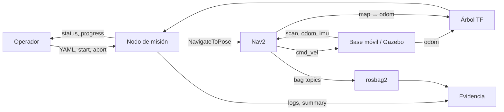
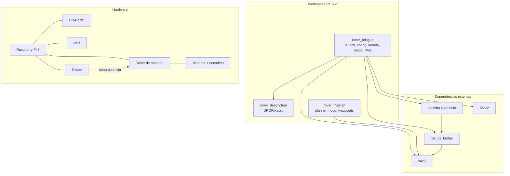
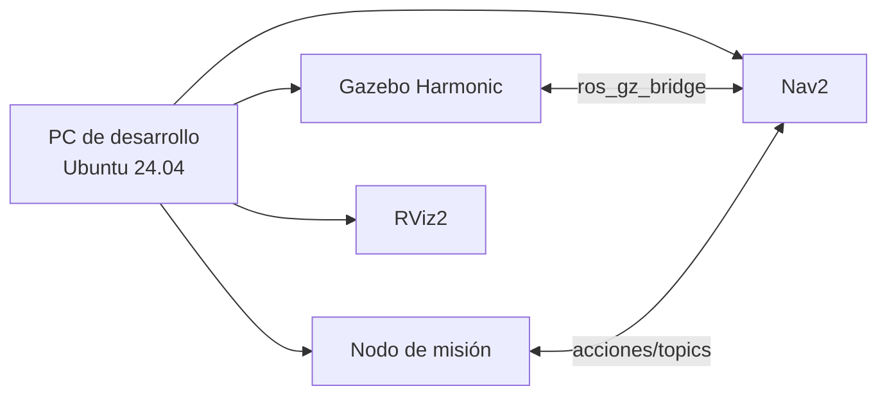
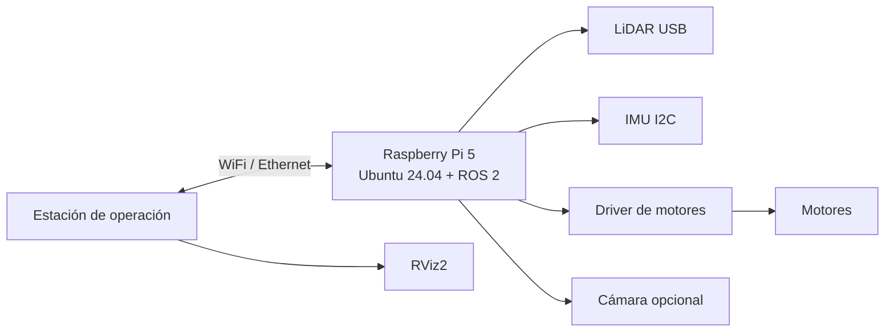
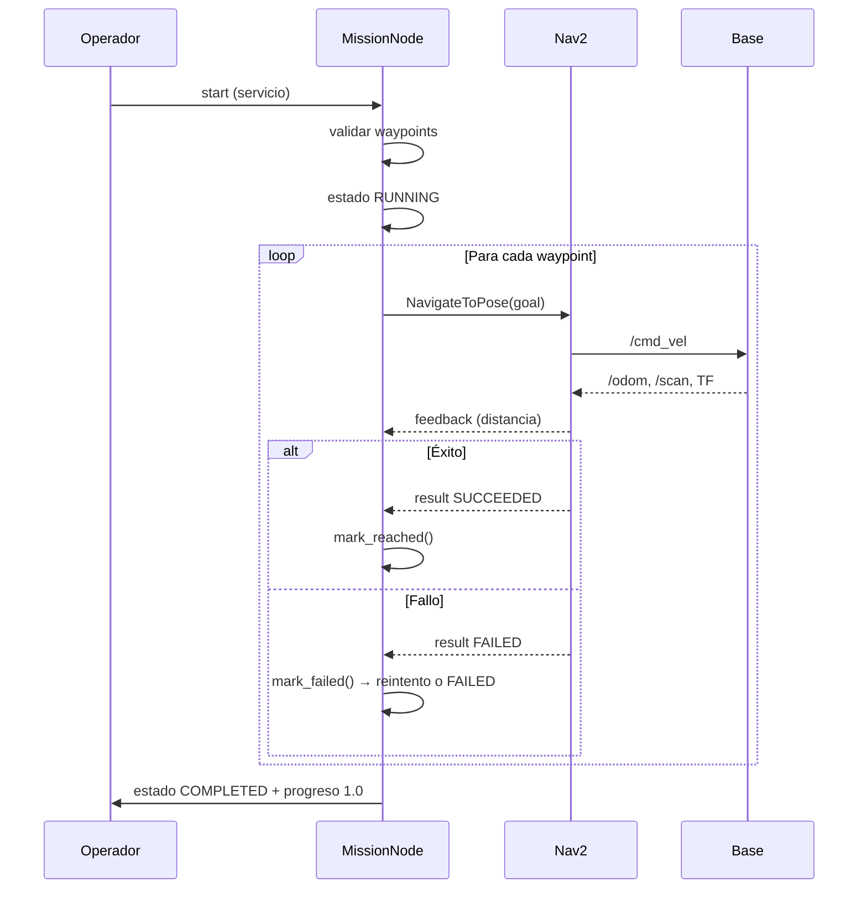
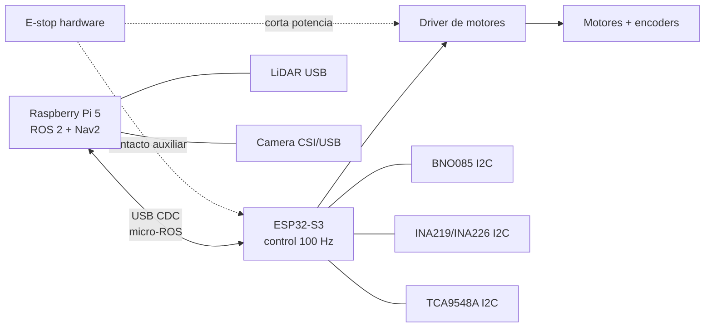

# Arquitectura del sistema

> Estado: Borrador · Versión: 0.1 · Revisión: 2026-11-21 · Responsable: rol de Tech Lead

## 1. Vista de contexto

**Actores**

- **Operador:** inicia, observa, aborta. No teleopera durante la misión.
- **Jurado / evaluador:** consume evidencia y presentación.
- **Equipo:** mantiene el sistema.

**Sistemas externos**

- Nav2 (planificación, control, localización).
- Gazebo Harmonic (simulación).
- RViz2 (visualización).
- Sistema operativo Ubuntu 24.04 + ROS 2 Jazzy.

## 2. Vista de componentes

### Responsabilidades

| Componente | Responsabilidad | No hace |
|---|---|---|
| `rover_description` | URDF, frames, geometría, inercia, plugins de simulación | No lanza nodos ni navega |
| `rover_bringup` | Launch, parámetros, mundo, mapa, RViz, bridges | No implementa lógica de misión |
| `rover_mission` | Cargar misión, orquestar Nav2, publicar estado, reintentos | No calcula trayectorias |
| Nav2 | Localización, planificación, control, recuperación | No decide la secuencia de waypoints |
| Gazebo | Física, sensores, reloj de simulación | No sustituye a Nav2 |
| `ros_gz_bridge` | Traducir topics ROS ↔ Gazebo | No transforma semántica |

## 3. Vista de despliegue

### 3.1 Simulación

- Todo corre en el mismo host.
- `use_sim_time: true`.
- El reloj lo publica Gazebo en `/clock`.

### 3.2 Hardware

- El Pi ejecuta Nav2, el nodo de misión y los drivers.
- La estación de operación solo visualiza y envía comandos de alto nivel.
- RViz2 no se ejecuta en el Pi para no consumir CPU.
- La e-stop corta la potencia de motores de forma independiente.
- **Spike de percepción 3D (ADR-0009):** la variante con 2 × CM3 + ToF se
  evalúa como spike; no sustituye esta arquitectura hasta que pase E5.

## 4. Flujo de misión

## 5. Flujo de datos

| Dato | Origen | Destino | Frecuencia | Formato |
|---|---|---|---|---|
| Waypoints | Archivo YAML | Nodo de misión | Al iniciar | `rover_mission/WaypointList` (JSON/YAML) |
| Objetivo | Nodo de misión | Nav2 | Por waypoint | `nav2_msgs/NavigateToPose` |
| Velocidad | Nav2 | Base | 20 Hz | `geometry_msgs/Twist` |
| Odometría | Base | Nav2 | 20–50 Hz | `nav_msgs/Odometry` |
| LiDAR | Sensor | Nav2 | 10 Hz | `sensor_msgs/LaserScan` |
| IMU | Sensor | Nav2 / EKF | 50 Hz | `sensor_msgs/Imu` |
| TF | Varios | Todos | 20–50 Hz | `tf2_msgs/TFMessage` |
| Estado | Nodo de misión | Operador | 2 Hz | `std_msgs/String` (JSON) |
| Progreso | Nodo de misión | Operador | 2 Hz | `std_msgs/Float32` |

Detalle en [`interfaces.md`](interfaces.md).

## 6. Principios de diseño

1. **Separación de responsabilidades:** la misión no planifica; Nav2 no decide la secuencia.
2. **Configuración sobre código:** waypoints, mapa y parámetros en YAML, no hardcodeados.
3. **Simulación primero:** todo se valida en Gazebo antes de tocar hardware.
4. **Fallo seguro:** si algo falta, el rover no se mueve.
5. **Evidencia por defecto:** cada ejecución deja rastro.
6. **Una sola fuente de verdad para la arena:** `arena.json` genera mundo y mapa.
7. **Portabilidad:** el mismo paquete de misión en sim y hardware.

## 7. Modos de operación

| Modo | Descripción | Quién lo usa |
|---|---|---|
| `SIM` | Gazebo + Nav2 + misión | Desarrollo y validación |
| `HW` | Pi + sensores + driver | Demo física |
| `DRY_RUN` | Valida misión y configuración sin mover motores | Preflight |
| `RECOVERY` | Teleoperación controlada para salir de una situación | Operador |

## 8. Fallos y degradación

| Fallo | Detección | Respuesta | Requisito |
|---|---|---|---|
| Pérdida de LiDAR | Timeout de `/scan` | Parar, estado `FAILED` | RF-03 |
| Pérdida de odometría | Timeout de `/odom` | Parar, estado `FAILED` | RF-04 |
| Pérdida de TF | `tf2` timeout | Parar, log | RF-04 |
| Waypoint inalcanzable | Resultado Nav2 | Reintento o `FAILED` | RF-11 |
| Batería baja | Voltaje | Abortar y estado `BATTERY_LOW` | RF-13 |
| Pi colgado | Watchdog externo | Cortar motores | RNF-04 |
| E-stop | Hardware | Cortar motores | RNF-04 |
| Pérdida de WiFi | Heartbeat | El rover sigue la misión local; el operador pierde telemetría | RF-05 |

## 9. Decisiones arquitectónicas

| ADR | Decisión |
|---|---|
| [ADR-0001](adr/0001-ros2-jazzy.md) | ROS 2 Jazzy |
| [ADR-0002](adr/0002-raspberry-pi-5.md) | Raspberry Pi 5 |
| [ADR-0003](adr/0003-nav2.md) | Nav2 |
| [ADR-0004](adr/0004-gazebo-harmonic.md) | Gazebo Harmonic |
| [ADR-0005](adr/0005-mapa-estatico-amcl.md) | Mapa estático + AMCL |
| [ADR-0006](adr/0006-python-mision.md) | Nodo de misión en Python |
| [ADR-0007](adr/0007-evidencia-reproducible.md) | Evidencia reproducible |
| [ADR-0008](adr/0008-esp32-interfaz-tiempo-real.md) (propuesta) | ESP32-S3 como interfaz de tiempo real |

## 10. Riesgos arquitectónicos

- **Acoplamiento a Nav2:** si Nav2 cambia de API, hay que adaptar el nodo. Mitigación: interfaz `NavigateToPose` estable y capa fina.
- **Dependencia de Gazebo:** la simulación no reproduce el terreno real. Mitigación: validar en pista y documentar la brecha.
- **AMCL con mapa estático:** si la arena cambia, falla. Mitigación: regenerar mapa desde `arena.json` y validar.
- **CPU del Pi:** MPPI puede ser inviable. Mitigación: RPP y límites de frecuencia.
- **Un solo punto de fallo en la e-stop:** si falla el relé, los motores podrían quedar alimentados. Mitigación: diseño normalmente cerrado y prueba periódica.

## 11. Propuesta: Pi 5 + ESP32-S3 (ADR-0008, en revisión)

> Esta sección describe una alternativa **propuesta**. No sustituye la
> arquitectura aceptada hasta que se apruebe el
> [ADR-0008](adr/0008-esp32-interfaz-tiempo-real.md).

| Componente | Responsabilidad |
|---|---|
| Raspberry Pi 5 | Nav2, AMCL, SLAM, LiDAR, cámara, misión, rosbag2, EKF |
| ESP32-S3 | PWM, dirección, encoders, IMU, batería, e-stop, watchdog, I²C |
| Driver | Puente H; recibe PWM/dirección y potencia de la batería |
| E-stop | Corta la potencia del driver en hardware; el MCU solo la supervisa |

**Por qué:** la Pi 5 no es de tiempo real y no tiene PWM suficiente para la
variante 6×6. El S3 aporta 45 GPIO, 8 LEDC, 2 MCPWM, 4 PCNT y 2 I²C, con
micro-ROS sobre USB. La variante C6 es suficiente para el demo de 2 motores,
pero tiene menos margen para 6×6.

**Consecuencia en la BOM:** añadir ~S/ 195 de interfaz (S3, mux I²C, level
shifter, optoacoplador, protoboard, cable y caja). No está incluido en el total
base de [`bom-peru.md`](../04-diseno/bom-peru.md).
