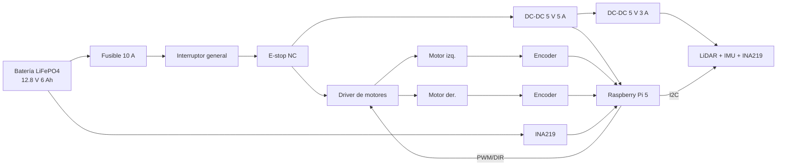

# Diseño eléctrico (conceptual)

> Estado: Conceptual · Versión: 0.1 · Revisión: 2026-11-21 · Responsable: rol de Hardware
> **Aviso:** esquema preliminar. Verificar corrientes, secciones y protecciones con los datasheets antes de montar.

> **Variante 6×6 (estudio paralelo):** el cálculo está en
> [`energia/calculo-energetico.md`](energia/calculo-energetico.md), el diseño
> eléctrico en [`energia/diseno-electrico-6x6.md`](energia/diseno-electrico-6x6.md)
> y la BOM en [`energia/bom-6x6.md`](energia/bom-6x6.md). **No sustituye** esta
> base de 2 motores + LiFePO4 hasta que se apruebe OQ-09. No mezclar ambas BOM
> ni comprar hardware de la variante sin decisión.
>
> Las secciones de potencia, driver, pinout y protecciones (2–5 y 8–10) de este
> documento no aplican al rover 6×6.
>
> **Impacto de la cotización en Perú:** [`bom-peru.md`](bom-peru.md) propone
> motores FIT0185 (7 A de bloqueo por motor) y una batería de 10 Ah con BMS de
> 10 A. Antes de montar, revisar el fusible principal, el BMS y el cableado; el
> diseño de 6 Ah/10 A puede quedar marginal con esos motores. Los riesgos están
> en la sección 7 de esa cotización.

## 1. Diagrama de bloques

## 2. Presupuesto de potencia

| Carga | Voltaje | Corriente típica | Potencia típica | Pico |
|---|---|---|---|---|
| Raspberry Pi 5 | 5 V | 1.2 A | 6 W | 12 W |
| LiDAR | 5 V | 0.5 A | 2.5 W | 3 W |
| IMU | 3.3 V | 0.01 A | 0.03 W | — |
| INA219 | 3.3 V | 0.001 A | — | — |
| Driver | 12 V | 0.1 A | 1.2 W | 2 W |
| Motores (2) | 12 V | 0.5 A | 6 W | 30 W |
| Ventilador | 5 V | 0.2 A | 1 W | 1.5 W |
| Pérdidas DC-DC | — | — | 1.5 W | 2.5 W |
| **Total** | | | **≈ 18 W** | **≈ 51 W** |

### Autonomía

\[
E = 12.8\ \text{V} \cdot 6\ \text{Ah} = 76.8\ \text{Wh}
\]

\[
t \approx \frac{76.8 \cdot 0.8}{18} \approx 3.4\ \text{h}
\]

Con un consumo medio de 18 W y un 80% de descarga útil, la autonomía teórica supera las 3 horas; el requisito es 30 min. El margen cubre picos y degradación. **Medir en banco antes de confiar en el cálculo.**

## 3. Alimentación

| Rail | Fuente | Consumidor | Protección |
|---|---|---|---|
| 12.8 V | Batería | Driver, DC-DC | Fusible 10 A |
| 5 V | DC-DC 5 V 5 A | Pi 5 | Fusible 3 A |
| 5 V | DC-DC 5 V 3 A | LiDAR, ventilador | Fusible 2 A |
| 3.3 V | Pi | IMU, INA219 | — |

- Usar DC-DC con salida regulada y rizado bajo.
- El Pi 5 puede consumir picos de 5 A; elegir una fuente de 5 V/5 A reales.
- Añadir condensadores de 470–1000 µF en la entrada de los drivers.

## 4. Driver de motores

| Requisito | Valor |
|---|---|
| Canales | 2 |
| Corriente continua | ≥ 10 A por canal |
| Voltaje | 6–24 V |
| Control | PWM + DIR, lógica 3.3 V compatible |
| Protecciones | Sobrecorriente, térmica, undervoltage |

**Opciones:** Cytron MDD10A (puente H doble, 10 A), BTS7960 (menos ideal para 3.3 V), driver con encoder integrado.

> Si el driver no acepta lógica 3.3 V, usar level shifter o un microcontrolador intermedio.

## 5. Encoders

- Encoder incremental en cuadratura, 5 V.
- Señales A/B al Pi con level shifter a 3.3 V o divisor resistivo.
- Frecuencia máxima estimada: 2.640 cuentas/vuelta × 50 rpm / 60 ≈ 2.2 kHz; el Pi puede leerlas por interrupciones, pero es preferible un microcontrolador si se añaden más tareas de tiempo real.

## 6. Monitor de batería

- INA219 por I2C (dirección 0x40).
- Mide voltaje, corriente y potencia.
- Alimentado a 3.3 V; el bus I2C del Pi es de 3.3 V.
- El nodo de batería (futuro) publica `/rover/battery` y aborta bajo umbral.

## 7. E-stop

- Pulsador de seta, normalmente cerrado, con enclavamiento.
- En serie con la alimentación del driver.
- Contacto auxiliar para que el Pi detecte el estado (con optoacoplador).
- Rearme manual; nunca automático.
- Prueba antes de cada sesión.

## 8. Pinout propuesto (BCM)

> **Propuesta ADR-0008:** este pinout es para conexión directa a la Pi. Si se
> aprueba el ESP32-S3 como interfaz, los PWM, dirección y encoders pasan al MCU
> y la Pi conserva USB, LiDAR y cámara. Ver sección 12.

| Función | GPIO | Nota |
|---|---|---|
| PWM motor izquierdo | 12 | Hardware PWM |
| DIR motor izquierdo | 23 | — |
| PWM motor derecho | 13 | Hardware PWM |
| DIR motor derecho | 24 | — |
| Encoder izq. A | 5 | Interrupción |
| Encoder izq. B | 6 | Interrupción |
| Encoder der. A | 16 | Interrupción |
| Encoder der. B | 26 | Interrupción |
| E-stop sense | 27 | Entrada con pull-up |
| I2C SDA | 2 | INA219 / IMU |
| I2C SCL | 3 | INA219 / IMU |

> Verificar el mapa de pines de la Raspberry Pi 5 y no usar pines reservados. Documentar el cableado real con una foto.

## 9. Conexiones y protecciones

| Elemento | Especificación |
|---|---|
| Conector batería | XT60 |
| Conector motores | XT30 o bornera |
| Fusible principal | 10 A |
| Fusible lógica | 3 A |
| Interruptor | 12 V 20 A |
| Cable motores | 18 AWG |
| Cable lógica | 22–24 AWG |
| Tierra | Estrella, un solo punto |

## 10. Pruebas eléctricas

| Prueba | Criterio |
|---|---|
| Continuidad | Sin cortos entre 12 V y GND |
| Tensión de rails | 5.0 V ± 0.25 V |
| Consumo en reposo | < 300 mA |
| Consumo con motores | < 5 A |
| E-stop | Corta 12 V del driver |
| Fusible | Se abre ante cortocircuito controlado |
| Temperatura | < 60 °C tras 30 min |

## 11. Pendiente

- Esquema eléctrico definitivo (KiCad).
- Cálculo de secciones con longitudes reales.
- Protección de inversión de polaridad.
- Conector de carga y balanceo.
- Certificación y seguro.

## 12. Propuesta de interfaz ESP32-S3 (ADR-0008, en revisión)

> **No sustituye** el diseño aceptado hasta que se apruebe el
> [ADR-0008](../03-arquitectura/adr/0008-esp32-interfaz-tiempo-real.md). La Pi 5
> sigue siendo el cerebro; el ESP32-S3 ejecuta el control de tiempo real.

### 12.1 Reparto de potencia y señal

| Elemento | Propuesta |
|---|---|
| Alimentación del MCU | 5 V 3 A (segundo DC-DC), no el USB de la Pi |
| Lógica | 3,3 V; sensores I²C a 3,3 V |
| Encoders FIT0185 | 5 V → adaptador de nivel de 4 líneas |
| Driver | MDD10A (1 PWM + 1 DIR por motor) o 2 × BTS7960 (2 PWM + enable por motor) |
| E-stop | Contacto NC corta potencia del driver; contacto auxiliar vía PC817 al MCU |
| I²C | BNO085 + INA219/INA226 + TCA9548A; pull-ups 2,2–4,7 kΩ |
| Masa | Estrella en el negativo de la batería; lógica separada de potencia |
| Precarga | 100 Ω / 5 W para condensadores del driver |

### 12.2 Protecciones para batería Li-ion 3S2P/3S3P

| Elemento | Valor | Nota |
|---|---|---|
| Fusible principal | 15 A (3S2P) / 25 A (3S3P), curva lenta | Protege células y arnés |
| Fusible de motor | 10 A por rama | Dos ramas |
| Relé de potencia | 12 V 30 A | La seta corta la bobina; el relé corta 15–25 A |
| BMS | 3S, 25 A; confirmar balanceo | Verificar que tenga balanceo de celdas |
| Cargador | 12,6 V, 3 A | Perfil Li-ion, supervisado |
| Conector | XT60 | 30 A nominal |
| Cable principal | 14 AWG | Corto |
| Cable de motor | 16–18 AWG | Según longitud |
| Precarga | 100 Ω / 5 W | Evita chispa al conectar |

> Con 3S2P la corriente máxima teórica es 20,4 A (2 × 10,2 A); con 3S3P,
> 30,6 A. Para vida útil, tratar 8 A por celda como techo continuo. El fusible
> principal de 15 A (3S2P) o 25 A (3S3P) y los de rama de 10 A protegen el
> arnés, no sustituyen al BMS.

### 12.3 I²C y expansión

| Dispositivo | Dirección | Bus | Nota |
|---|---|---|---|
| BNO085 | 0x4A/0x4B | I²C principal | 3,3 V; fusión interna |
| INA219 | 0x40 | I²C principal | Shunt de 0,1 Ω; hasta 26 V |
| INA226 | 0x40/0x41 | I²C principal | Alternativa con shunt externo |
| TCA9548A | 0x70 | I²C principal | 8 canales para direcciones repetidas |
| PCA9685 (6×6) | 0x41 | Canal del mux | Servos; lógica de 5 V, level shifter |

> El LiDAR y la cámara **no** van al ESP32: siguen en USB/CSI de la Pi. El MCU
> solo maneja sensores de baja tasa y actuadores.

### 12.4 Pendiente de esta propuesta

- Validar el pinout del ESP32-S3-DevKitC-1 N16R8 y evitar pines de strapping,
  USB y PSRAM.
- Medir latencia de micro-ROS y CPU del MCU con el bucle de 100 Hz.
- Diseñar el arnés o shield; después, PCB propia.
- Probar el _watchdog_ y la e-stop con fallo provocado.
- Revisar el reglamento ERC 2027 y la certificación del pack Li-ion.
