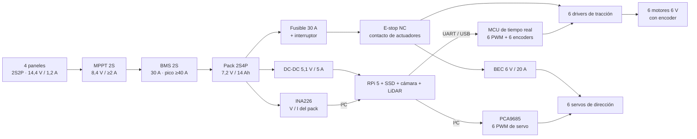

# Diseño eléctrico — variante 6×6 (estudio)

> Estado: Estudio · Versión: 0.1 · Revisión: 2026-11-21 · Responsable: Diseño electrónico

> **No es la base del mini demo.** Esta variante usa 6 motores, 6 servos,
> pack Li-ion **2S4P de 8 celdas** y paneles solares. La base vigente sigue
> siendo el rover de 2 motores con LiFePO4 de 12,8 V. Adoptar esta variante
> requiere resolver **OQ-09** y aprobar un ADR de energía. **No comprar hardware
> de esta BOM** hasta entonces y no mezclarla con la BOM base.

## 1. Alcance

Diseño eléctrico conceptual para un rover de 6 ruedas con tracción y dirección
independientes. Se apoya en el cálculo energético
[`calculo-energetico.md`](calculo-energetico.md) y en el motor de referencia
Pololu 25D LP 6 V 99:1 con encoder (F-005). El motor y el servo definitivos
siguen sin elegir; por eso el diseño se presenta con dos opciones de driver y
con valores de corriente marcados como supuestos.

## 2. Diagrama de bloques

## 3. Presupuesto de potencia

| Carga | Potencia típica | Nota |
|---|---:|---|
| Raspberry Pi 5 + SSD + cámara + LiDAR + ventilador | 9,28 W en batería | Riel de 5,1 V, 90 % de rendimiento |
| 6 servos de dirección | 3,30 W en batería | Media con 10 % de actuación, BEC al 85 % |
| **Electrónica** | **12,58 W** | Reposo con motores parados |
| Tracción en llano a 0,30 m/s | 7,86 W | 6 motores, 2 A de bloqueo cada uno |
| Tracción en pendiente del 10 % | 14,67 W | Peor caso de operación normal |
| **Crucero** | **20,44 W** | Electrónica + tracción en llano |
| **Pendiente del 10 %** | **27,25 W** | Electrónica + tracción en pendiente |
| **Falla: 6 motores y 6 servos bloqueados** | **187,2 W** | 26,0 A en el pack; solo para dimensionar protecciones |

Detalle y fórmulas en [`calculo-energetico.md`](calculo-energetico.md).

## 4. Batería y autonomía

**Pack 2S4P de 8 celdas 18650 de 3,6 V / 3500 mAh:**

| Parámetro | Valor |
|---|---:|
| Tensión nominal | 7,2 V (6,0–8,4 V) |
| Capacidad | 14 Ah |
| Energía | 100,8 Wh |
| Energía útil al 80 % de descarga | 80,6 Wh |
| Autonomía media | 4,39 h |
| Misiones de 45 min | 5,9 |
| RNF-06 (≥30 min) | ≈8,8× de margen |
| Masa extra de celdas | +192 g frente a 2S2P |

- BMS de 2S de **puerto común**, 30 A continuos, ≥40 A de pico y corriente de
  carga ≥5 A, con equilibrado y sensor de temperatura.
- Fusible principal de **30 A** de curva lenta, cable de **14 AWG**.
- Cargador externo de **8,4 V / 5 A CC-CV** (≈3 h); con 2 A serían ≈7 h.
- Celdas con descarga continua ≥10 A; el pico de falla de 2S4P es 6,5 A por
  celda, así que hay margen. Aun así, limitar la corriente de drivers y servos.
- La variante 2S1P (2 celdas) no se recomienda: su pico de falla sería de
  26 A por celda.
- El pack añade ~192 g al rover; revisar el par de dirección y el reparto de
  masa. El MG995 de 10 kg·cm sigue teniendo margen a 6,2 kg, pero el servo de
  20 kg·cm es más recomendable.

## 5. Rieles y convertidores

| Riel | Tensión | Carga | Dimensionado |
|---|---|---|---|
| Tracción | 7,2 V nominal, PWM limitado al 83 % a 7,2 V (6 V equivalentes) | 6 motores, 2 A de bloqueo cada uno | 6 canales de 2 A; drivers con límite de corriente |
| Pi 5 | 5,1 V | 1,7 A típicos; 5 A máximos oficiales | Convertidor de 5 A (25 W), cable USB-C |
| Servos | 6 V | 6 servos, 2,5 A de bloqueo cada uno | BEC de 20 A (120 W), fusible de 20 A |
| Carga solar | 8,4 V | 2 A | MPPT de 2S Li-ion, ≥2 A |

- El Pi 5 se alimenta con **5,1 V / 5 A** para no limitar los puertos USB
  (F-001). No alimentar el Pi desde el riel de servos.
- El BEC de 6 V es independiente del riel de 5 V. Su corriente de bloqueo
  agregada puede superar los 15 A.
- Todos los convertidores deben tener protección de sobrecorriente y
  sobretemperatura. Verificar el rizado con osciloscopio antes de conectar el
  Pi.

## 6. Tracción

### 6.1 Motor de referencia

| Parámetro | Valor |
|---|---:|
| Modelo | Pololu 25D LP 6 V 99:1 con encoder (item 4827) |
| Tensión nominal | 6 V |
| Corriente en vacío | 120 mA |
| Corriente de bloqueo | 2,0 A |
| Par de bloqueo | 9,1 kg·cm |
| Velocidad en vacío | 130 rpm |
| Encoder | 48 CPR en el eje del motor |

No es una selección definitiva: es el motor con el que se calcularon consumo y
autonomía. Si se cambia por un 37D de 12 V o por un motor de mayor corriente,
hay que recalcular el pack, los drivers y el fusible.

### 6.2 Drivers

| Opción | Cantidad | Ventaja | Limitación |
|---|---:|---|---|
| TB6612FNG dual | 3 | 1 A continuo / 3 A de pico por canal; bajo coste | 18 GPIO de control para 6 motores |
| DRV8871 o equivalente | 6 | 2 pines por motor (PWM + DIR); menos GPIO | Verificar que el pico soporte el bloqueo del motor |

- Regla: `I_continua ≥ 1,5 × I_nominal` y `I_pico ≥ I_bloqueo`.
- Añadir un límite de corriente de **2 A por motor** para proteger el pack y
  los engranajes.
- Condensadores de 470–1000 µF en la entrada de cada driver y un TVS en el
  riel de motores.
- No montar los drivers cerca del Pi ni de la cámara; el ruido de conmutación
  afecta a los encoders y al I²C.

### 6.3 Encoders y control

- 6 encoders en cuadratura, 5 V; adaptar a 3,3 V con level shifter o divisor.
- El Pi 5 no tiene 12 entradas de encoder ni 18 PWM de hardware. La tracción
  se gobierna desde un **MCU dedicado** (Teensy 4.1 para 3× TB6612, o RP2040
  para 6× DRV8871).
- El MCU recibe `/cmd_vel` del Pi por UART/USB, genera los PWM y publica la
  odometría de las 6 ruedas.
- Watchdog de 200 ms: si el Pi deja de enviar consignas, el MCU pone los
  motores en freno y los servos en posición segura.

## 7. Dirección

- 6 servos de **≥10 kg·cm** (clase MG995/MG996R); se recomienda **20 kg·cm**
  para 6–10 kg y uso off-road.
- El MG90S (2,2 kg·cm) **no es suficiente**: a 6 kg se necesitan 4,8 kg·cm con
  factor de seguridad 2.
- Driver PCA9685 de 16 canales por I²C; solo se usan 6.
- Alimentación desde el BEC de 6 V / 20 A, con condensadores de 100 µF cerca
  de cada servo y 1000 µF en la entrada del BEC.
- **Servo saver** o embrague mecánico en cada rueda para proteger los
  engranajes ante impactos.
- No alimentar los servos desde el riel de 5 V del Pi.

## 8. Solar

- 4 paneles de 7,2 V / 600 mA en **2S2P**: 14,4 V nominales, 1,2 A.
- MPPT para 2S Li-ion, salida **8,4 V / ≥2 A**, con sensor de temperatura.
- Diodos de bloqueo Schottky por rama y bypass en cada panel si no vienen
  integrados.
- Producción estimada: 28–35 Wh/día con 3 h de sol pico. No sostiene los
  20,4 W de crucero; solo extiende la autonomía. Con el pack 2S4P, una recarga
  solar completa tarda 2,9–3,6 días; para las mangas, cargar de red.
- No conectar los cuatro paneles en paralelo (7,2 V) directamente al pack 2S:
  la tensión de carga es 8,4 V y no llegaría.

## 9. Protecciones y e-stop

| Elemento | Especificación |
|---|---|
| Fusible principal | 30 A, curva lenta, junto al positivo del pack |
| Fusible del Pi | 5 A en el ramal de 5,1 V |
| Fusible de servos | 20 A en el ramal del BEC de 6 V |
| Fusibles de motor | 5 A por driver o bloque de distribución fusible |
| Interruptor general | 30 A, corte bipolar |
| E-stop | NC, enclavado, 2 polos o contactor de 40 A; corta tracción y servos, no el Pi |
| Protección de polaridad | MOSFET P / diodo ideal en la entrada del pack |
| Precarga | Resistencia de 100 Ω / 5 W para la carga de condensadores |
| Tierra | Estrella en el negativo del pack; señal y potencia separadas hasta el punto común |
| Cableado | 14 AWG principal, 16 AWG motores/servos, 18–22 AWG lógica |

El e-stop debe cortar físicamente la alimentación de los actuadores. Si se usa
un contactor, la bobina se alimenta a través del pulsador NC y se enclava
manualmente; el Pi conserva alimentación para registrar el evento.

## 10. Control y direcciones I²C

| Bus / señal | Dispositivo | Dirección / pin | Nota |
|---|---|---|---|
| I²C | PCA9685 | 0x41 | Cambiar la dirección de fábrica 0x40 |
| I²C | INA226 | 0x40 | Shunt de 0,002 Ω, 2 W, lado de alta |
| UART / USB | MCU de tracción | `/dev/ttyACM0` o similar | Protocolo binario o micro-ROS |
| GPIO Pi | E-stop sense | Entrada con optoacoplador | Detecta el estado del e-stop |
| GPIO Pi | Heartbeat del MCU | Entrada | Si falta, el Pi aborta la misión |

> **Conflicto de dirección:** PCA9685 e INA226 usan 0x40 de fábrica. Hay que
> cambiar uno de los dos antes de montar el bus. En esta propuesta, el PCA9685
> pasa a 0x41.

## 11. Pruebas eléctricas

| Prueba | Criterio |
|---|---|
| Continuidad y polaridad | Sin cortos entre 7,2 V y GND; polaridad correcta |
| Rieles | 5,1 V ±0,25 V; 6,0 V ±0,3 V; pack 6,0–8,4 V |
| Consumo en reposo | < 0,6 A en el pack (Pi + sensores + servos en hold) |
| Corriente por motor | ≤ 2 A con límite activo; sin disparo térmico |
| Corriente de servos | ≤ 2,5 A por servo en bloqueo breve; BEC estable |
| E-stop | Corta tracción y servos; el Pi sigue registrando |
| Fusible | Se abre ante cortocircuito controlado |
| Temperatura | < 60 °C tras 30 min de operación |
| Autonomía | TC-18: ≥30 min (esperado ≈4,4 h); registrar V/I con INA226 |

## 12. Pendientes y decisión

1. **OQ-09:** decidir si la arquitectura vigente es la base 2 motores/LiFePO4
   o esta variante 6×6/Li-ion/solar.
2. **ADR de energía** si se adopta la variante.
3. Motor definitivo y su curva I-V.
4. Servo definitivo y su corriente de bloqueo real.
5. Radio de rueda, `scrub radius` y masa pesada.
6. Ensayo térmico y de vibración del pack y de los drivers.
7. Esquema KiCad y mazo de cables definitivo.

## 13. Enlaces

- Cálculo energético: [`calculo-energetico.md`](calculo-energetico.md)
- BOM de la variante: [`bom-6x6.md`](bom-6x6.md)
- Diseño eléctrico base: [`../diseno-electrico.md`](../diseno-electrico.md)
- BOM base: [`../bom.md`](../bom.md)
- Fuentes: [`../../01-investigacion/fuentes.md`](../../01-investigacion/fuentes.md)
- OQ-09: [`../../00-gobierno/registro-decisiones.md`](../../00-gobierno/registro-decisiones.md)
